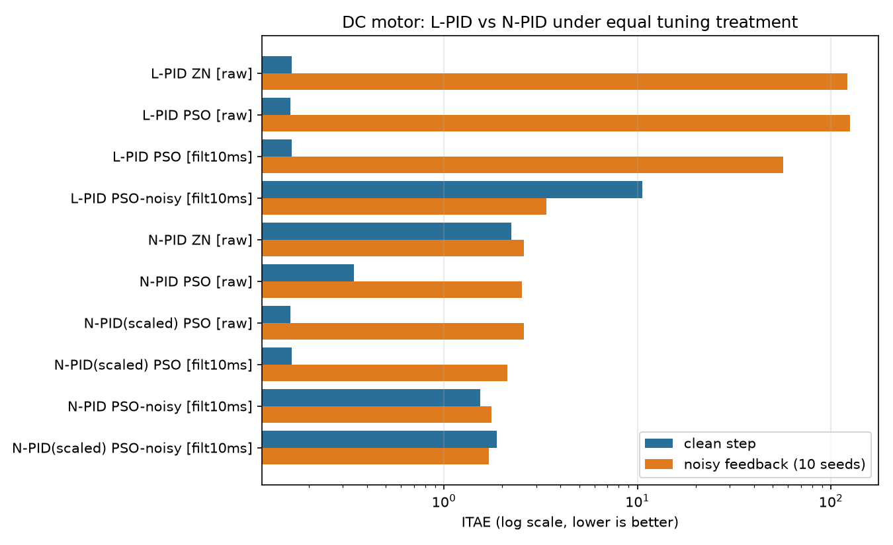
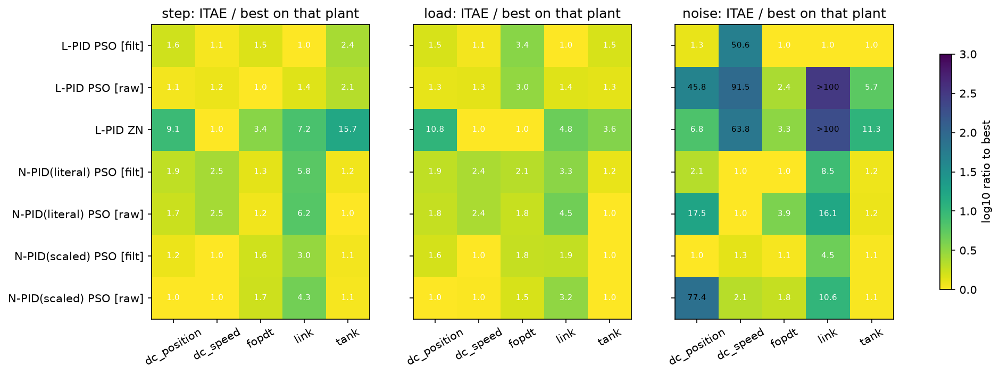
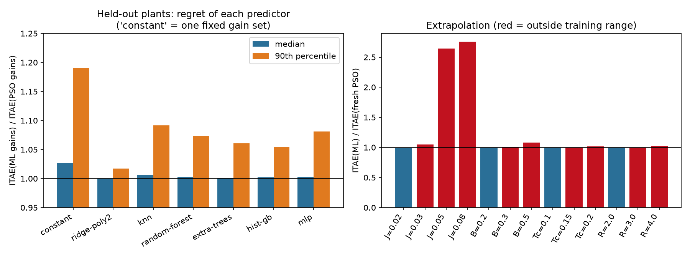
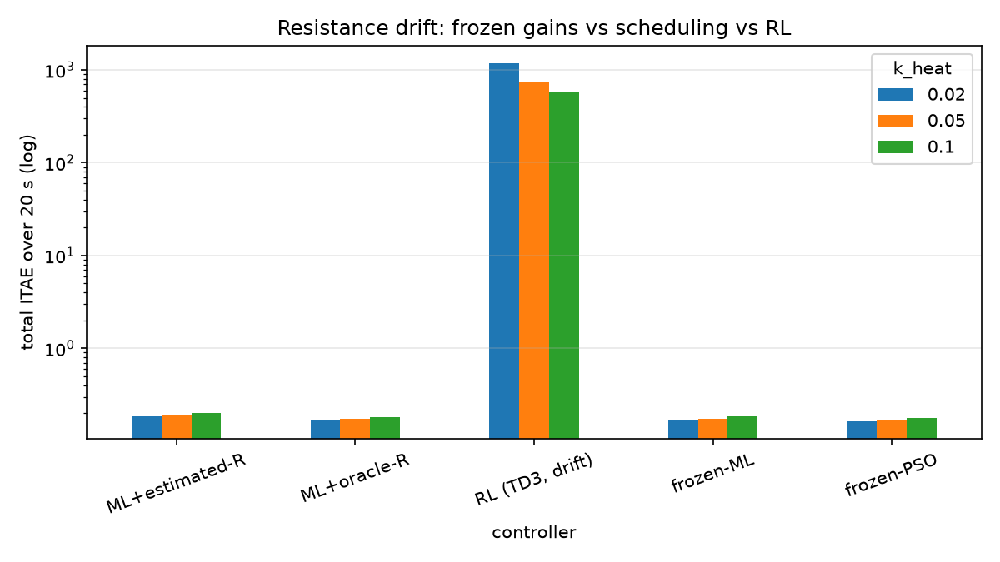

# N-PID Tuning: Re-evaluation and Extension (v2)

This report supersedes the headline claims of `final_report.md` and `phase5_rl_report.md` (kept unchanged as a record of the original work). It is a generic, plant-independent re-evaluation of the methods surveyed in Çelik et al. (2026): linear PID (L-PID), nonlinear PID with error-shaped gains (N-PID, paper Eq. 9-12), Ziegler-Nichols (ZN) and PSO tuning, ML gain prediction, and online RL adaptation. Every number below is produced by a script in `experiments/` and stored in `results/v2/`; `progress.md` has the full engineering log.

## 1. What changed in the method

| Area | Before | Now |
|---|---|---|
| Plants | DC motor hard-wired into the simulator | Generic `Plant` interface: transfer function, state space, arbitrary ODE, dead time, drifting parameters; the closed loop, tuners and metrics work on all of them |
| Baselines | N-PID PSO-tuned, L-PID only ZN-tuned, raw derivative | Both controllers get the same PSO treatment (log-space box, best of 3 restarts), with and without a derivative low-pass, and with noise-aware tuning |
| N-PID shaping | Raw error in rad/s | Optional scale-free form (`e_scale`, `de_scale`) |
| ZN | Coarse detector (13% error) | Half-cycle amplitude-ratio detector (<0.5% error) + relay-feedback tuner |
| Dataset | 42% of rows had unreachable setpoints | Setpoint = 15-85% of each plant's maximum speed; seeded, resumable; 1200 rows |
| ML eval | R², RF vs MLP | Regret in closed-loop ITAE, constant-gain baseline, extrapolation sweeps |
| Verification | none | 38 pytest tests, bit-identical regression against the original numerics |

One deviation from the paper is deliberate: Eq. 9 read literally gives `Kp·α(e)·e = e²/(…)`, which loses the sign of the error and cannot close a feedback loop. The implementation uses `P = Kp·α(e)` with `α(e) = e/(1+|e|ⁿ)^(1/n)`, which has the behaviour the paper describes (linear for small e, saturating for large e).

## 2. Results

### 2.1 Is N-PID better than L-PID once the comparison is fair? (DC motor, `01`)


- **Clean step:** a PSO-tuned L-PID (ITAE 0.160) is as good as the best N-PID (scale-free, 0.160). Paper-literal N-PID is worse (0.24-0.34). The original "N-PID (ZN) 2.27 vs L-PID (ZN) 0.16" gap was a scaling and tuning artefact.
- **Noise:** an unfiltered L-PID collapses (ITAE ~120). N-PID's advantage comes mainly from γ(de/dt) switching the derivative off. A filtered, noise-tuned L-PID closes most of the gap (3.4 vs 1.7), so the honest claim is a ~2x noise advantage and a better clean/noisy compromise (N-PID keeps 1.5-1.9 clean while L-PID tuned for noise degrades to 10.6), not 50x.
- **Shaping is not scale-free.** Paper-literal α, β, γ depend on the plant's units and the setpoint; this matters for any learning method trained across operating points.

### 2.2 Does it generalise across plant types? (`05`)


Five plants (DC speed, DC position, gravity-loaded single link, first-order plus dead time, nonlinear tank). **There is no universal winner**:
- N-PID is clearly better on the nonlinear tank (state-dependent gain; about half the ITAE) and under noise on the DC speed loop.
- L-PID is better on the gravity-loaded link (N-PID overshoots ~40%) and on the dead-time plant.
- ZN is a poor baseline on most plants; PSO is far better, except on the DC speed loop where all are close.
- Single-seed PSO can fail outright (ITAE 954 vs 1.7-4.4 on other seeds, dead-time plant); all PSO results use best-of-3.

### 2.3 Tuning-method accuracy (`02`)
On plants with analytic ultimate points, the new ZN detector is within 0.5% of the true Kcr/Tcr and relay feedback within 5%. **The DC motor has no true ultimate gain** (relative degree 2, minimum phase); the Kcr used by the original project was a chattering limit cycle caused by 1 ms sampling, stiff friction smoothing and voltage saturation. ZN is a reasonable starting box for PSO there, but not a principled baseline.

### 2.4 ML gain prediction (`03`, `04`)


- The labels are only weakly determined by the plant: PSO cost is repeatable (CV ≤1.3%) but the gains vary 12-150% across seeds at equal cost.
- On 197 held-out plants, every predictor, **including a single constant gain set**, is within 3% (median) of per-plant PSO. Learned models mostly tighten the tail (90th percentile regret 1.19 → 1.02-1.09). A polynomial ridge regression is as good as RF/boosting/MLP.
- Speed: ~25 s per fresh PSO vs ~1 ms per prediction (≈25,000x); true, but the gain matters only because the labels are expensive, not because the tuning problem is hard.
- Extrapolation is safe for B, Tc and R up to 2x the training range, and for J up to 1.5x; J = 0.05-0.08 (2.5-4x) gives 2.6-2.8x worse ITAE.
- The legacy dataset was invalid for 42% of its rows (unreachable setpoints).

### 2.5 Is RL needed for parameter drift? (`06`)


For armature-resistance drift up to 3x, frozen gains lose only 7% ITAE, and gain scheduling (even with the true R) cannot improve on that. The Phase-5 TD3 agent is three to four orders of magnitude worse (ITAE 574-1179 vs 0.17). At 7x drift the setpoint becomes unreachable at 24 V and every controller fails identically. The old master table reported one identical drift number for four different controllers and used PSO gains as the "frozen ML" baseline; both are corrected.

## 3. Limitations and caveats
- One principal plant family for ML (DC motor speed); the multi-plant study compares controllers and tuners, not ML across plants.
- PSO budget is small (16 x 25, best of 3 for evaluation tables, a single seed per dataset label); differences of a few percent are not significant.
- Measurement noise is white Gaussian on the output only; no sensor quantisation, actuator rate limits or model mismatch.
- Shaping scales (`e_scale = |ref|`, `de_scale = |ref|/Ts`) are heuristics, untuned.
- RL was not retrained: the drift scenario offers no headroom for any adaptive method. A meaningful RL study needs a harder scenario (large step changes in inertia/friction or operation near the voltage limit) compared against the cheap estimator-based baseline in `06`.

## 4. Reproducing
```
pip install -r requirements-dev.txt
pytest                       # 38 tests, ~75 s
python run_v2.py             # all experiments except dataset generation
python run_v2.py --with-dataset   # also regenerates the 1200-row dataset (~1 h)
```

## 5. Suggested next steps (kept general, as requested)
1. Extend the review's other N-PID structures (e.g. fuzzy/neural gain scheduling, sliding-mode hybrids) behind the same `compute(error)` interface and rerun experiments `01`/`05` unchanged.
2. Add actuator/sensor non-idealities (rate limits, quantisation, delay) as plant wrappers.
3. Make the ML study plant-agnostic: features from plant step-response signatures instead of motor parameters.
4. Revisit RL on a drift/regime-change scenario where frozen gains demonstrably degrade.
