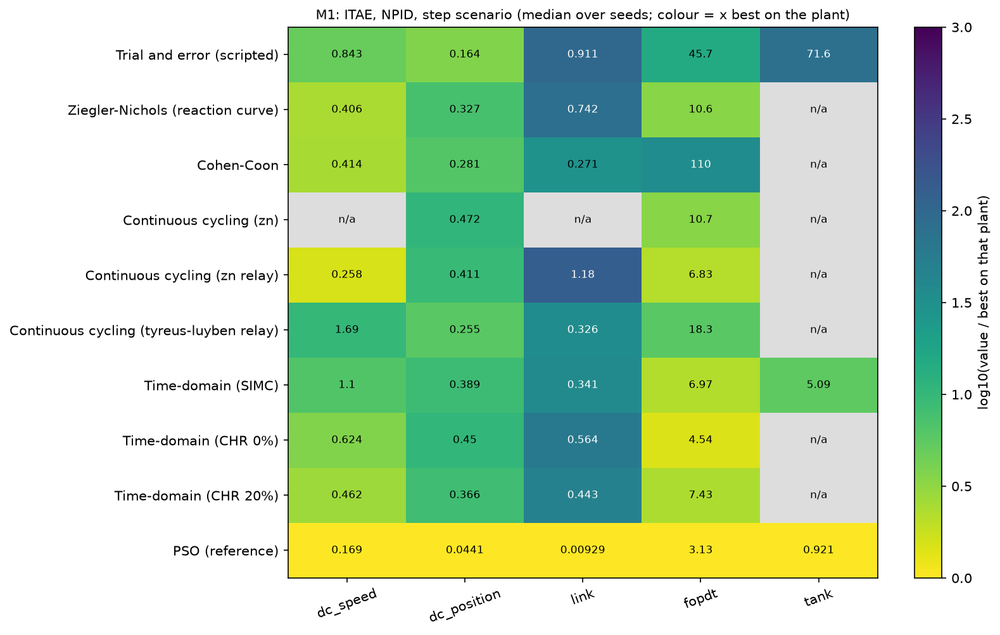
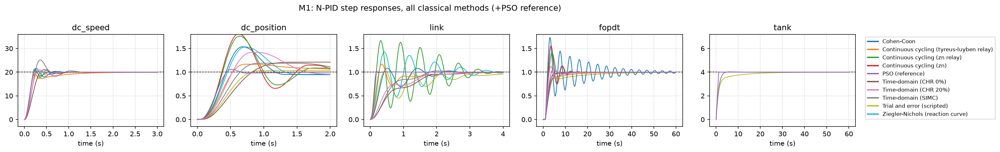
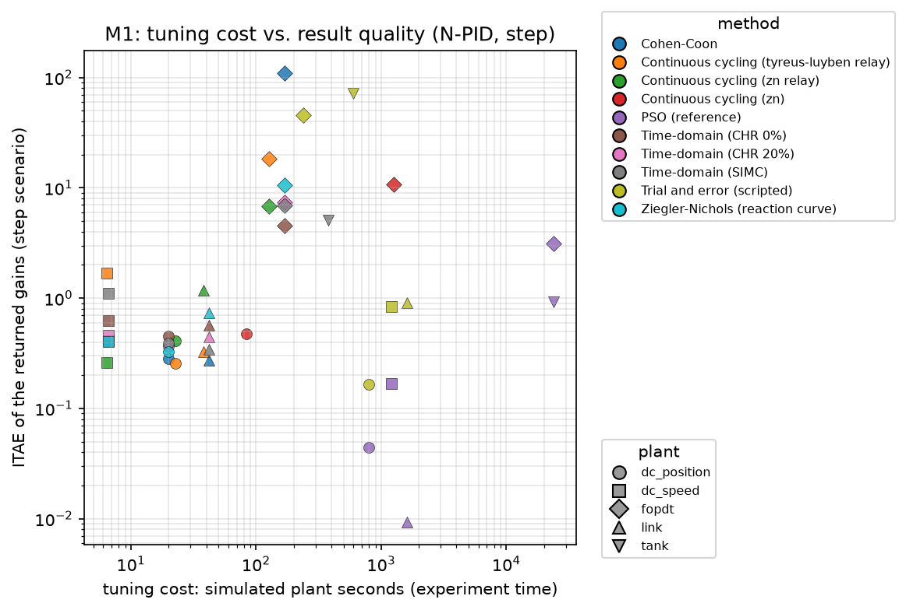

# M1 — Classical Tuning Methods for the N-PID Controller

*Phase M1 of `docs/METHODS_ROADMAP.md`; protocol in `docs/PROTOCOL.md`; engineering log in `progress.md`. All numbers are produced by `experiments/m1_classical.py` and stored in `results/methods/M1/` (CSV) and `results/methods/M1/figures/` (PNG). The framework (M0) it relies on is described in section 2.*

## 1. Summary

Five classical families were implemented as eight variants behind one interface (`src/tuners/classical.py`) and benchmarked on five plants of different character, with a PSO reference as yardstick.

1. **Classical rules are cheap and fast, but worse in ITAE than an optimizer** on the clean step: the best rule per plant is 1.5–29× worse, individual rules up to ~130× worse, and no rule is best everywhere. Their tuning cost is 6–380 simulated seconds (bump-test and relay methods) against 800–24 000 s for 400-evaluation PSO.
2. **They are more conservative than clean-trained optimization, which pays off under noise**: on `dc_speed` and the tank, PSO gains tuned on the noise-free step are 2.7× and 4.2× worse than the best classical rule once measurement noise is added.
3. **Applicability is the dominant issue, not accuracy.** 9 of 45 (method, plant) pairs are not applicable; the open-loop rules cannot be used on a plant without dead time (tank, θ/τ ≈ 0.005), and the ultimate-cycle method needs a phase crossover that two of the five plants do not have. Applied outside their validity range, the rules do not fail gracefully (section 7.2).
4. **The classical "ultimate gain" of the DC speed loop is not a measurable quantity**: it varies between 64 and 129 depending on the observation horizon and threshold (section 7.4), and the legacy project's value of 232 was one more arbitrary point on that curve.
5. **A linear PID rule is a poor proxy for the N-PID.** With identical gains, the N-PID is better in 9 of 36 cells, similar in 10 and worse in 17 (median ITAE ratio 1.07, step). The shaping does act as a gain limiter for near-unstable rules (Cohen-Coon on the dead-time plant: ITAE 110 on the N-PID, 316 on the L-PID).
6. **Trial and error is not a stable reference**: changing the acceptance thresholds of the scripted engineer changes its ITAE by up to 12× on a plant (section 7.6).

## 2. Framework used (M0)

| Component | File | Role |
|---|---|---|
| `TuningProblem` | `src/tuners/base.py` | The only handle a method has on the plant: plant factory, setpoint, sampling time, horizon, actuator limits, disturbance/noise settings; **every experiment is counted** (evaluations and simulated seconds) |
| `Tuner`, `TuningResult`, `NotApplicable` | `src/tuners/base.py` | Common interface; a method that cannot handle a plant must say so instead of returning gains |
| Process identification | `src/tuners/identify.py` | Operating-point search (damped secant), bump test, FOPDT / SOPDT / IPDT fits (least squares, two-point, tangent), identification under noise |
| Benchmark | `src/tuners/benchmark.py` | Independent evaluation of returned gains on N-PID and L-PID, step / disturbance / noise (10 seeds), failure flags |
| Plots | `src/tuners/plots.py` | Step overlays, ratio heat maps, cost-vs-performance, identification overlays |

**Generality.** No method contains plant constants. Plants outside "stable or integrating, positive gain" raise `NotApplicable` (checked by tests with an unstable and an unreachable-setpoint plant). The time scale `Ts` used for shaping, filter and search box is estimated from one open-loop step, not supplied. Identification handles self-regulating plants (FOPDT/SOPDT) and integrating plants (IPDT), including nonlinear plants linearised at the setpoint operating point; the 5 benchmark plants identify as: DC speed FOPDT (K 1.47, τ 0.13, θ 0.07), DC position IPDT, link FOPDT (lightly damped, nrmse 0.04), dead-time plant FOPDT (exact: K 2.005, τ 5.00, θ 0.994), tank FOPDT (K 3.37, τ 8.5, θ ≈ 0; analytic linearisation K 3.2, τ 8) — figure `M1_identification.png`.

## 3. Controller, scenarios, metrics, budget

As in the protocol: N-PID with scale-free shaping (n = m = p = 2, `e_scale = |y_ref|`, `de_scale = |y_ref|/Ts`), derivative low-pass τ_d = Ts/20, the identical gains also evaluated on an L-PID. Scenarios: clean step, input disturbance step, measurement noise (10 seeds). Metrics: rise time, overshoot, settling time, IAE, ISE, ITAE, control effort. PSO reference: pyswarms, 16 particles, 400 evaluations, 5 seeds, log-space search in the generic box (protocol change P1, section 9). Classical methods are deterministic (one run).

## 4. Methods

For every method: idea, algorithm, requirements, assumptions, implementation, expected strengths and weaknesses; observed behaviour follows in sections 6–8.

### 4.1 Trial and error (`TrialAndError`)
*Idea.* Manual tuning on the closed-loop step response of the actual N-PID. *Algorithm.* A scripted, deterministic emulation: start with Kp = 0.1·u_lim/|y_ref|; loop with priorities (1) diverging / oscillating / overshoot > 40% → back off (Kp ×0.6, Ki ×0.5, Kd ×0.8); (2) rise time > 0.5·Ts → Kp ×1.5; (3) steady-state error > 2% → Ki = Kp/(2Ts), then ×1.5; (4) overshoot > 15% → Kd = Kp·Ts/8, then ×1.5; else accept. Maximum 40 trials; the best trial by ITAE plus overshoot penalty is returned. *Needs:* no model, only the ability to run the loop. *Cost:* one closed-loop simulation per trial. *Assumption/limitation:* a human cannot be simulated exactly; the thresholds are mine, and the result depends on them (ablation F). *Pros:* no identification, works on any plant and on the nonlinear controller itself. *Cons:* many trials, outcome depends on the engineer's criteria and stopping rule, no optimality notion.

### 4.2 Ziegler–Nichols, open-loop reaction curve (`ZieglerNicholsReactionCurve`)
*Algorithm.* Bump test at the operating point; graphical tangent at the point of maximum slope gives apparent dead time L and slope R = K/τ of the unit-step response (Savitzky–Golay derivative); PID: Kp = 1.2/(R·L), Ti = 2L, Td = 0.5L (R = Kv for integrating plants). Quarter-amplitude-decay design. *Needs:* a step test, a self-regulating or integrating plant, θ/τ in [0.1, 1] (strict mode). *Cost:* 3–6 open-loop experiments. *Pros:* simple, cheap, no iteration. *Cons:* aggressive (25–60% overshoot), tangent construction is sensitive to noise and curve shape, unusable for θ → 0. *Note:* the legacy project's "ZN" was the *closed-loop* method (4.4), not this one.

### 4.3 Cohen–Coon (`CohenCoon`)
*Algorithm.* FOPDT from the two-point method (t₂₈, t₆₃); with r = θ/τ: Kp = (1/K)(τ/θ)(4/3 + r/4), Ti = θ(32 + 6r)/(13 + 8r), Td = 4θ/(11 + 2r); for integrating plants the τ → ∞ limit (Kp = 4/(3Kvθ), Ti = 32θ/13, Td = 4θ/11). *Pros:* compensates for large dead time better than ZN on paper. *Cons:* aggressive, small gain margin, very sensitive to identification error (ablation E), validity limited to θ/τ ∈ [0.1, 1] here.

### 4.4 Continuous cycling / ultimate-cycle method (`ContinuousCycling`)
*Algorithm.* Find the ultimate gain Ku and period Tu, then apply a rule set (ZN: 0.6Ku, Tu/2, Tu/8; Tyreus–Luyben: Ku/2.2, 2.2Tu, Tu/6.3; Pessen, some-overshoot, no-overshoot also implemented). Two ways to find them: (a) *oscillation search* — P-only loop, Kp doubled until the step response stops decaying (half-cycle amplitude ratio ≥ 0.999), bisection to 1%; (b) *relay feedback* (Åström–Hägglund): relay of amplitude d about the operating-point input with hysteresis h = 2% of the setpoint, Ku = 4d/(π√(a² − h²)), Tu from the limit cycle. *Needs:* a plant that reaches marginal stability under P control (dead time or relative degree ≥ 3); the experiment is run on the real saturating loop. *Pros:* no model; Ku, Tu are physically meaningful when they exist; relay is automatic and safe. *Cons:* the oscillation search drives the plant to its stability limit (hundreds of simulated seconds, risky on a real plant); the relay result depends on d and h (describing-function approximation); neither exists for plants without a phase crossover.
*Validation.* On an exact FOPDT the oscillation search reproduces the analytic Ku = 4.25, Tu = 3.72 within 3% (found Ku = 4.22); the relay is within 25% for Ku and 8% for Tu, as the describing-function theory predicts.

### 4.5 Approximate time-domain tuning (`TimeDomainTuning`)
*Idea.* Tune from specifications of the step response on the identified model. *SIMC* (Skogestad 2003): SOPDT model, Kp = τ₁/(K(τ_c + θ)), Ti = min(τ₁, 4(τ_c + θ)), Td = τ₂; integrating plants Kp = 1/(Kv(τ_c + θ)), Ti = 4(τ_c + θ), Td = τ; τ_c = θ, floored at 0.1·τ₁ when θ → 0 so the bandwidth stays within the actuator's reach (SIMC states τ_c ≥ θ). *CHR* (Chien–Hrones–Reswick, set-point, 0% and 20% overshoot): Kp = 0.6τ/(Kθ), Ti = τ, Td = 0.5θ and Kp = 0.95τ/(Kθ), Ti = 1.357τ, Td = 0.473θ. *Pros:* an explicit speed/robustness knob (τ_c) or overshoot specification, SIMC has no validity ratio and works for θ → 0. *Cons:* needs a good model (SOPDT fit); CHR keeps ZN's validity limits; "approximate" because the closed-loop specification is met only if the plant resembles the model.

## 5. Validation before evaluation (protocol section 9)

84 tests pass (`pytest`), 46 of them specific to M0/M1 (24 identification, 5 benchmark, 17 classical methods): identification recovers exact FOPDT/SOPDT/IPDT models (least squares exact, two-point ≈ 2%, tangent ≈ 9% on τ), is robust to noise, classifies the benchmark plants correctly (analytic linearisations for the motor and tank), rejects unstable / unreachable plants; each classical rule reproduces its textbook formula on an exact plant (ZN, Cohen–Coon, CHR 0/20%, SIMC for FOPDT and SOPDT, integrating variants); the oscillation search matches the analytic Ku/Tu; relay within describing-function error; strictness and `NotApplicable` behaviour; trial-and-error determinism and budget; cost accounting.

## 6. Results

### 6.1 N-PID performance (ITAE, lower is better; median over seeds; `n/a` = method not applicable)

| method | dc_speed | dc_position | link | fopdt | tank |
|---|---|---|---|---|---|
| Trial and error (scripted) | 0.843 | 0.164 | 0.911 | 45.7 | 71.6 |
| Ziegler–Nichols (reaction curve) | 0.406 | 0.327 | 0.742 | 10.6 | n/a |
| Cohen–Coon | 0.414 | 0.281 | 0.272 | 110 | n/a |
| Continuous cycling (ZN, oscillation) | n/a | 0.472 | n/a | 10.7 | n/a |
| Continuous cycling (ZN, relay) | 0.258 | 0.411 | 1.18 | 6.83 | n/a |
| Continuous cycling (Tyreus–Luyben, relay) | 1.69 | 0.255 | 0.326 | 18.3 | n/a |
| Time-domain (SIMC) | 1.10 | 0.389 | 0.341 | 6.97 | 5.09 |
| Time-domain (CHR 0%) | 0.624 | 0.450 | 0.564 | **4.54** | n/a |
| Time-domain (CHR 20%) | 0.462 | 0.366 | 0.443 | 7.43 | n/a |
| *PSO reference (400 evals)* | *0.169* | *0.044* | *0.0093* | *3.13* | *0.921* |

Overshoot of the classical results (N-PID, step, %): ZN reaction curve 7 / 62 / 45 / 55 (dc_speed / dc_position / link / fopdt), Cohen–Coon 8 / 61 / 8 / 75, ZN relay 3 / 62 / 65 / 42, Tyreus–Luyben relay ≈0 / 9 / 18 / ≈0, SIMC 26 / 4 / 3 / ≈0 (and 0.6 on the tank), CHR 0% 5 / ≈0 / ≈0 / ≈0, CHR 20% 5 / 47 / ≈0 / 12; PSO 3 / 6 / 3 / 6 / 0.01. The classical rule families therefore span "oscillatory" (ZN, Cohen–Coon, relay-ZN) to "sluggish but smooth" (CHR 0%, Tyreus–Luyben, SIMC).

### 6.2 Under measurement noise (ITAE, N-PID, mean of 10 noise seeds)

| method | dc_speed | dc_position | link | fopdt | tank |
|---|---|---|---|---|---|
| Ziegler–Nichols (reaction curve) | 0.648 | 0.331 | 0.826 | 17.4 | n/a |
| Cohen–Coon | 0.571 | 0.284 | 0.288 | 111 | n/a |
| Continuous cycling (ZN, relay) | 0.472 | 0.421 | 1.26 | 12.0 | n/a |
| Time-domain (SIMC) | 1.19 | 0.390 | 0.349 | 8.94 | 11.2 |
| Time-domain (CHR 0%) | 0.710 | 0.454 | 0.565 | 7.67 | n/a |
| *PSO reference (trained on the clean step)* | *1.30* | *0.044* | *0.168* | *6.77* | *47.2* |

The classical rules lose comparatively little under noise (ITAE change between 0 and about +120%, e.g. ZN reaction curve on `fopdt` 10.6 → 17.4, SIMC on the tank 5.09 → 11.2, Cohen–Coon on `fopdt` unchanged at ~110); the clean-trained optimum loses a lot on `dc_speed` (7.7×), `link` (18×) and the tank (51×), and ends up *worse* than SIMC on the tank (47 vs 11) and than five of the eight applicable rules on `dc_speed` (1.30 vs 0.47–0.71 for ZN, Cohen–Coon, relay-ZN, CHR 0%/20%). This reproduces the v2 finding that noise-blind optimization produces aggressive gains.

### 6.3 Tuning cost (simulated plant seconds; median)

| method | dc_speed | dc_position | link | fopdt | tank |
|---|---|---|---|---|---|
| ZN reaction curve / Cohen–Coon / CHR / SIMC (one bump test) | 7 | 20 | 42 | 170 | 378 |
| Continuous cycling, relay | 6 | 23 | 38 | 127 | 288 |
| Continuous cycling, oscillation search | n/a | 84 | n/a | 1 260 | n/a |
| Trial and error (≤ 40 trials) | 1 200 | 800 | 1 600 | 240 | 600 |
| PSO, 400 evaluations | 1 200 | 800 | 1 600 | 24 000 | 24 000 |

A bump-test method needs 3–6 experiments and under 2% of the simulated time of 400-evaluation PSO (0.6–1.6%). The oscillation search costs ~10× a bump test and, on a real plant, would drive the loop to its stability limit. The wall-clock cost in this benchmark is ~1 s for the open-loop rules, 5–9 s for the oscillation search and trial and error, 45 s for PSO.

### 6.4 Applicability matrix (N-PID step; ok / n/a with reason)

| method | dc_speed | dc_position | link | fopdt | tank |
|---|---|---|---|---|---|
| Trial and error | ok | ok | ok | ok | ok |
| ZN reaction curve, Cohen–Coon, CHR | ok | ok | ok | ok | **n/a** (θ/τ = 0.005) |
| Continuous cycling, oscillation | **n/a** (no ultimate gain) | ok | **n/a** (no ultimate gain) | ok | **n/a** (period at sampling limit) |
| Continuous cycling, relay | ok (artefact-prone) | ok | ok | ok | **n/a** (oscillation set by hysteresis) |
| SIMC | ok | ok | ok | ok | ok |
| PSO | ok | ok | ok | ok | ok |

9 of the 45 (classical variant, plant) pairs are not applicable (20%): 3 for the oscillation search, 1 each for the other variants on the tank (ZN, Cohen–Coon, CHR 0%, CHR 20%, both relay variants), counted as 3 + 6 = 9. SIMC and trial and error are the only classical variants that cover all five plants.

### 6.5 What the nonlinearity adds with the same gains (RQ5)
Ratio N-PID/L-PID ITAE with identical gains over the 36 (method, plant) cells in which both exist: step — N-PID better (< 0.9) in 9, similar in 10, worse (> 1.1) in 17, median ratio 1.07; noise — 9 / 12 / 15, median 1.03. The N-PID is *not* systematically better when handed linear-design gains. Notable cells: Cohen–Coon on the dead-time plant, where the rule is close to instability, ITAE 110 (N-PID) vs 316 (L-PID) and overshoot 75% vs 116% (consistent with the shaping bounding the proportional action); ZN-relay on the link, ITAE 1.18 (N-PID) vs 0.11 (L-PID). The PSO reference was tuned on the N-PID, so its L-PID ratio only measures the mismatch.

## 7. Ablations

### A. Identification method for the open-loop rules (`M1_ablation_A_identification.csv`)
Tangent vs two-point vs least-squares FOPDT feeding ZN and Cohen–Coon. The choice changes ITAE by up to 6× and not in a consistent direction. On the dead-time plant, where the least-squares fit reproduces the true model exactly, the exact model gives the *worse* controller (ZN: 27.6 least squares vs 10.6 tangent; Cohen–Coon: 129 vs 21.7), plausibly because the rules were calibrated on graphical (tangent) estimates and the exact parameters make them more aggressive than intended; on the link the opposite holds (Cohen–Coon: 0.27 least squares vs 1.28 tangent). On the tank and `dc_position` the choice is irrelevant. Identification accuracy is therefore not what these rules reward, and the identification method has to be reported with the rule.

### B. Rules outside their validity range (`M1_ablation_B_validity.csv`, figure `M1_ablationB_validity.png`)
With `strict=False`, ZN/Cohen–Coon on the tank (θ/τ = 0.005) return Kp = 75–85, Ki = 860–935 — absurdly aggressive on paper; in this noise-free benchmark they happen to reach ITAE 0.918, equal to the optimum, because a plant with no dead time *can* be controlled that aggressively until sampling, noise or actuator rate matter. In other words the validity guard prevents a correct answer for the wrong reason; the noise robustness of such gains is not evidenced here (the PSO optimum for the same plant degrades 51× under noise).

### C. Rule sets for the ultimate-cycle method (`M1_ablation_C_rulesets.csv`)
No rule set wins everywhere (relay source, ITAE): Tyreus–Luyben best on `dc_position` (0.255), Pessen on `dc_speed` (0.228), some-overshoot on `link` (0.114), ZN on `fopdt` (6.84). The ratio between the worst and best rule set on a plant is 3× (`dc_position`), 3.6× (`fopdt`), 7.4× (`dc_speed`) and 26× (`link`), comparable to the spread between different methods.

### D. The limit-cycle "ultimate gain" is not a measurable quantity (`M1_ablation_D_limit_cycle.csv`, figure `M1_ablationD_limit_cycle.png`)
For the DC speed loop (no true ultimate gain), the "Ku" found by detecting a persistent limit cycle ranges from 64 to 129 as the observation horizon goes from 10 to 80 Ts and the detection threshold from 3·10⁻⁴ to 10⁻² of the setpoint (the legacy value 232 came from a different horizon and a decay-ratio criterion). Any ZN gains computed from it inherit a factor-2 arbitrariness.

### E. Identification under measurement noise (`M1_ablation_E_noise.csv`, figure `M1_ablationE_noise.png`)
Noise of 1–5% of the setpoint during the bump test shifts the identified parameters by at most 11% (median K 2.00 → 2.07, τ 5.0 → 4.5 on the dead-time plant at 5% noise) — but the Cohen–Coon gains derived from them give a median ITAE between 32 and 300 with 75th percentiles up to 2 700, against 129 for the noise-free identification, on the dead-time plant; on the DC motor the result is insensitive (median ITAE 0.44–0.46). A rule that sits near the stability limit amplifies small parameter errors into large, erratic performance differences.

### F. Variability of trial and error (`M1_ablation_F_trial_and_error.csv`, figure `M1_ablationF_trial_and_error.png`)
Over 27 combinations of acceptance thresholds (rise target 0.25/0.5/1.0 Ts, overshoot 10/15/25%, steady-state error 1/2/5%): ITAE ranges 0.84–6.65 (`dc_speed`), 28–79 (dead-time plant), 0.30–2.9 (link), 38–481 (tank), whereas `dc_position` is insensitive (0.136–0.164). A "manual tuning" row in a comparison table is only meaningful together with its stopping rule.

## 8. Analysis

**RQ1 (performance).** Against the optimizer, the best classical result per plant is 1.5× worse on `dc_speed` (relay-ZN 0.258 vs 0.169) and on the dead-time plant (CHR 0% 4.54 vs 3.13), 3.7× on `dc_position` (trial and error 0.164 vs 0.044), 5.5× on the tank (SIMC 5.09 vs 0.921) and 29× on `link` (Cohen–Coon 0.272 vs 0.0093). The ordering of classical methods changes from plant to plant; only the identification-based rules that produce smooth responses (CHR 0%, SIMC, Tyreus–Luyben) never produce an oscillatory step, but they are sluggish.

**RQ2 (cost).** Bump-test and relay methods spend 6–380 simulated seconds (the oscillation search up to 1 700) against 800–24 000 for optimization. Whether this matters depends on the plant: for a plant whose experiments are costly or risky it decides, for a plant that can be simulated it does not. The oscillation search is the exception: it is both expensive and dangerous on a physical plant.

**RQ3 (generality).** The strongest result of this phase: applicability, not accuracy, limits classical methods (section 6.4), and the failure modes are silent unless guarded (section 7.B, 7.D). Only SIMC and trial and error covered all plants.

**RQ4 (robustness).** Classical rules are far less noise-sensitive than clean-trained optimization (section 6.2), but the aggressive ones (Cohen–Coon, ZN) are fragile to identification error (7.E).

**RQ5 (nonlinearity).** With linear-design gains the N-PID is no better on average (section 6.5); its shaping helps the near-unstable rules and hurts others. Exploiting the nonlinearity requires tuning *with* the nonlinear controller in the loop (optimization, ML, M3–M6) or tuning its shape parameters.

### Pros and cons at a glance

| method | pros | cons | use when |
|---|---|---|---|
| Trial and error | no model, works on the real nonlinear controller | 40 trials, result depends on the stopping rule (up to 12×) | quick start, plant simulable |
| ZN reaction curve | one step test | aggressive (45–62% overshoot on three of the four plants where it applies), needs θ/τ ∈ [0.1, 1] | dead-time-dominant, a rough starting point |
| Cohen–Coon | one step test, designed for dead time | aggressive (75% overshoot on the dead-time plant, ITAE 110), erratic under identification noise (median ITAE 32–300, 75th percentile up to 2 700) | rarely; with a detuning factor |
| Continuous cycling (oscillation) | physically meaningful Ku/Tu, no model | needs phase crossover, drives plant to its limit, 10× the cost | simulation only, plants with delay |
| Continuous cycling (relay) | automatic, safe, cheap | depends on d and h, 20% describing-function error, n/a without crossover | process loops, auto-tuners |
| SIMC | covers all plants, explicit τ_c knob, smooth | needs SOPDT fit, sluggish for default τ_c | default classical choice |
| CHR 0% / 20% | explicit overshoot specification | validity θ/τ ∈ [0.1, 1], sluggish (0%) / oscillatory on integrators (20%) | when overshoot must be bounded |

## 9. Errors found and corrected during development (kept for transparency)

1. **Tangent method distorted by smoothing** at the dead-time kink (τ = 4.3 instead of ≈ 5): replaced the moving average by a Savitzky–Golay derivative (test `test_fopdt_fit_recovers_exact_model[tangent]`).
2. **`link` mis-identified as an integrator** (K = 10.2): a secant step went beyond the gravity-torque limit where the arm spins freely, which looked like a ramp. Fixed with a bracketed secant that treats "stops settling after earlier probes settled" as an upper bracket; regression test added.
3. **`tank` mis-identified as an integrator**: the first operating-point search probed the 10 V actuator limit where the nonlinear tank needs > 60 s to settle. Replaced by a search starting from 20% of the range, with experiments that stop when the output has settled (this also cut the counted experiment time by about 3× on the DC speed and dead-time plants, e.g. 480 → 170 s).
4. **Limit-cycle fallback horizon**: a limit cycle was declared on slowly decaying responses over a 3 s window (Ku = 86, then 112 at 9 s). Horizon lengthened to 40·Ts and the sensitivity measured (ablation D) instead of pinning a number.
5. **Protocol change P1 — search box too narrow** (`docs/PROTOCOL.md`): the first version of the generic gain box (Ki ≤ 10·kp0/Ts) excluded the optimum on the tank, so a classical rule applied outside its validity range beat the "reference" optimizer. Widened to 4–6 decades; M1 was re-run (all numbers above are from the corrected run; PSO improved on every plant).
6. Test errors (wrong expectations of my own, e.g. the number of experiments for a linear plant) and a clipped figure legend were fixed; no result depended on them.

## 10. Threats to validity and limitations
- Five plants, one setpoint and one noise level each; no claim about all plants.
- Identification experiments are noise-free in the main benchmark (noise is covered by ablation E on two plants).
- Trial and error is an emulation with thresholds chosen by me (ablation F quantifies the dependence).
- The PSO reference has 5 seeds and a 400-evaluation budget; seed spread is small except `dc_position` (0.040–0.101) and `link` (0.0069–0.0127).
- "Failure" follows the protocol's relative definition (ITAE > 100× the best method on that plant/scenario): with an optimizer as good as 0.0093 on `link`, three stable but poor classical results (ITAE 0.74–1.2, overshoot 45–65%) are flagged although the response is usable; the absolute behaviour is given in section 6.1.
- Gains are applied to a *nonlinear* controller; the approximation that its linear region equals the L-PID is measured (section 6.5), not assumed.

## 11. Conclusions and consequences for the next phases
1. Classical methods are best viewed as **generators of conservative starting points** whose value is speed and low experiment cost, not optimality.
2. Their **applicability limits** (dead time, phase crossover, identifiability of a linear model) are the main reason to move to optimization, ML or adaptive methods; a tuning study must report not-applicable cases rather than hide them.
3. SIMC (any plant, one knob) is the recommended classical baseline and Cohen–Coon / continuous cycling with ZN rules the ones to treat with care.
4. Phase M3 (optimizers) therefore must be judged on both clean performance *and* noise behaviour, on tuning cost, and on whether it reaches the (now correctly wide) box optimum; M4–M6 can use SIMC/CHR as warm starts (hybrid ML + classical, M5).
