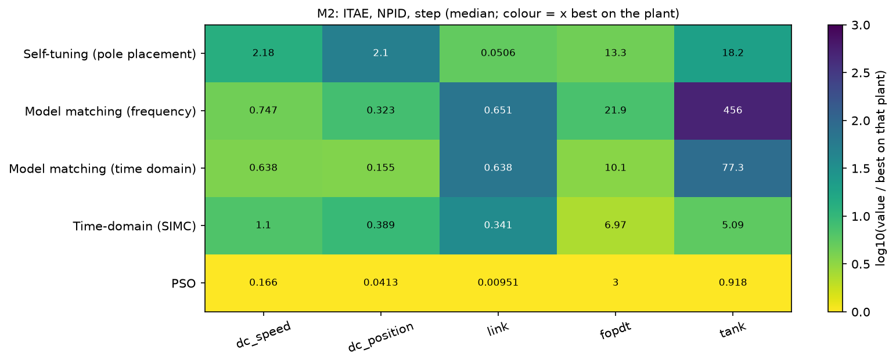
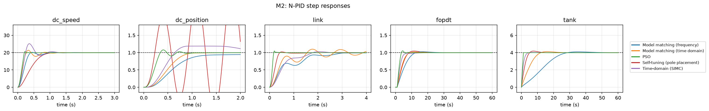
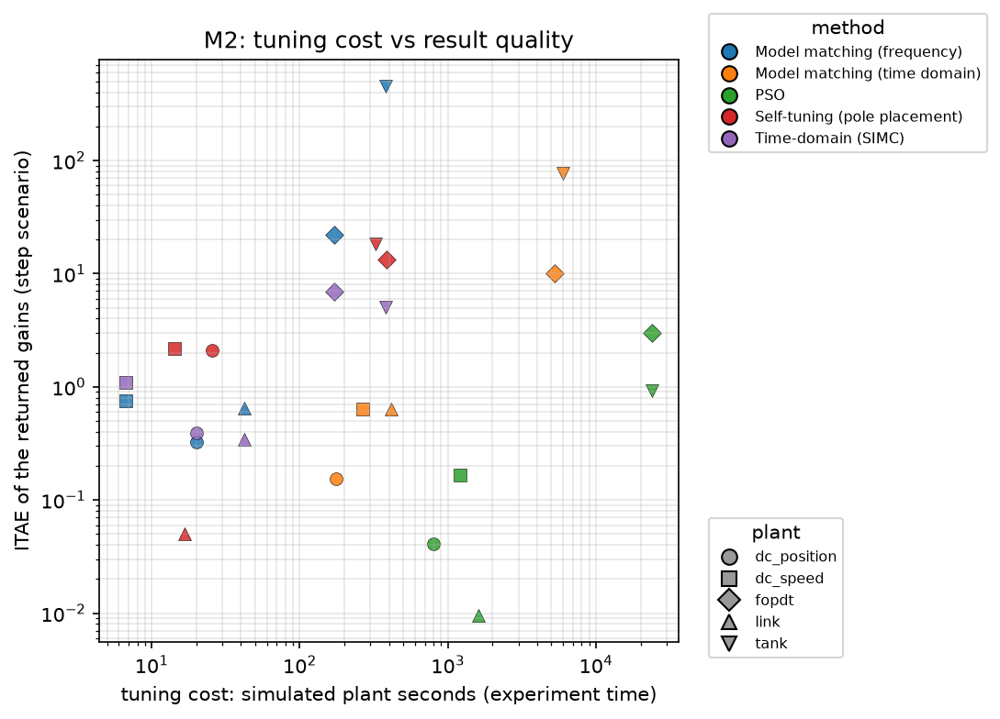
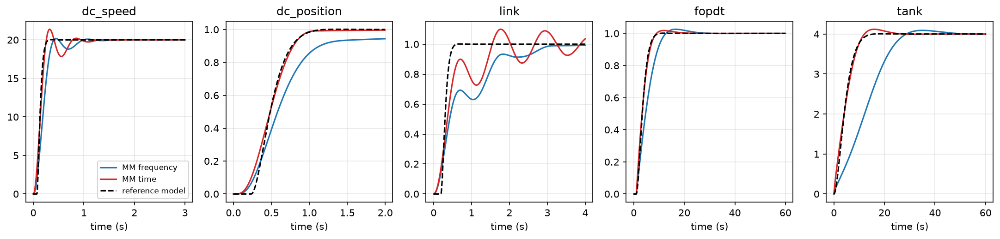
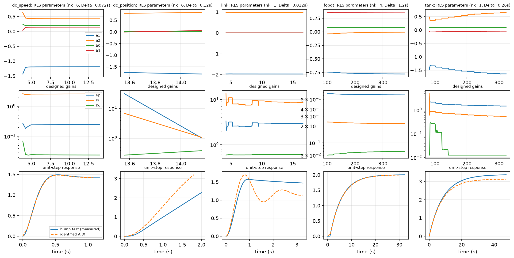

# M2 — Intelligent Tuning Methods for the N-PID Controller (Self-Tuning Pole Placement, Model Matching)

*Phase M2 of `docs/METHODS_ROADMAP.md`; protocol `docs/PROTOCOL.md`; log `progress.md`. Code: `src/tuners/selftuning.py`, `src/tuners/modelmatching.py`; experiment `experiments/m2_intelligent.py`; data `results/methods/M2/*.csv`, figures `results/methods/M2/figures/*.png`; tests `tests/test_tuners_selftuning.py` (33), `tests/test_tuners_modelmatching.py` (11).*

## 1. Summary

1. **Self-tuning pole placement** identifies a discrete model online (recursive least squares on a differenced ARX(2,2) model, delay chosen by a batch scan), places the closed-loop poles of a PID (or PI) on a requested pair (ωₙ, ζ) and adapts the gains during one closed-loop experiment (14–384 simulated seconds, **one** experiment). It returned usable gains on all five plants and gave the **best result of any non-optimizing method on the gravity link** (ITAE 0.051, 2% overshoot; best classical 0.27; PSO 0.0095), but is slower than the classical rules on the dead-time plant and the tank (13.3 vs 7.0; 18.2 vs 5.1 for SIMC).
2. **Model matching** (frequency-domain fit, 3–6 plant experiments; time-domain refinement, 82–99 closed-loop simulations) reproduces a specified reference response very closely — normalised matching error 4·10⁻⁴ to 1.6·10⁻² for the time-domain variant — but **ITAE is dominated by the chosen reference speed**: a reference one third as fast as the open loop yields ITAE up to 456 on the tank. Matching a reference is not the same as minimising ITAE.
3. **Neither method comes close to optimization-based tuning** (PSO 400 simulations: ITAE 0.0095–3.0), but both are, in ITAE, at the level of the classical rules, with a single exception each (self-tuning on the link, time-domain matching on `dc_position`: 0.155 vs best classical 0.164).
4. **Differences between the two implementations show how much implementation detail matters**: the first version of the self-tuner ran its controller at the fast simulation rate while identifying at a slower rate; the identified DC gain was biased by 47–78% (`dc_speed` 0.79 instead of 1.47, `link` 0.34 instead of 1.53, tank 1.05 instead of 3.37) and ablation results varied by 10–50× between neighbouring settings. Running the experiment as a *sampled-data* loop (zero-order hold at the identification period) removed most of the bias (identified DC gain 1.43 vs 1.47 on `dc_speed`, 2.00 vs 2.005 on the dead-time plant, 3.05 vs 3.37 on the tank, 1.18 vs 1.53 on the link) and the erratic behaviour.
5. **With identical gains the N-PID is not better than the L-PID** for these methods: of 15 (method, plant) cells it is better in 2, similar in 4 and worse in 9 (step ITAE ratio).
6. **Limits found**: the second-order, one-delay-sample model structure cannot represent the third-order integrating `dc_position` plant (its identified model has two slow poles of modulus 0.91 (time constants ≈ 1 s) instead of an integrator, and a step response 1.5× steeper than measured; a design is still produced, with Kp = 16, but is not trustworthy), the self-tuner is catastrophic (ITAE 3 320) when delay selection is disabled on a dead-time plant, and with a 2% excitation amplitude on the tank (ITAE 2 701).

## 2. Methods

### 2.1 Self-tuning pole placement (`SelfTuningPolePlacement`)
Following Åström & Wittenmark's self-tuning regulators. The method is used as an *auto-tuner*: run the experiment, adapt online, return the converged gains as static N-PID base gains. The same machinery (`RLS`, `pole_placement_pid`, `desired_wn`) is reused online in M6.

**Experiment.** The loop runs with a cautious initial controller (Kp = 0.05·u_max/|y_ref|, Ki = Kp/(5 Ts), Kd = 0). The setpoint is toggled ±`amp` (default 10%) around its nominal value with period 8 Ts for 8 periods. All plant access is counted as one experiment. **Sampled-data operation**: the controller runs at the identification period Δ with zero-order hold (see section 8, error 3); Δ₀ = Ts/20 for the first two periods, then Δ = nk·Δ₀ once the delay is known (so that the delay is one sample).

**Model.** Differenced ARX, A(q⁻¹) Δy(k) = B(q⁻¹) Δu(k−1), A = 1 + a₁q⁻¹ + a₂q⁻², B = b₀ + b₁q⁻¹ (differences remove the operating-point offset and constant disturbances). Structure selection on the first two periods: ARX(2,2,nk) for nk = 1…6, smallest nk within 5% of the best loss; for integrating plants an alternative structure with the input *level* and an offset term, (1 + a₁′q⁻¹)Δy = B u + c, chosen by Akaike's criterion. RLS with forgetting factor λ = 0.995 warm-started from the batch least-squares solution (θ and its information matrix).

**Design.** Velocity-form PID with the problem's derivative filter τ_d: closed-loop polynomial c(z⁻¹) = (1 − z⁻¹)(1 − ρz⁻¹)A + z⁻¹B S, ρ = τ_d/(τ_d + Δ), S = s₀ + s₁z⁻¹ + s₂z⁻². The four coefficients are matched to the poles (ωₙ, ζ) plus a real **double auxiliary pole at z = −γ**, γ found by a root search (three PID parameters plus γ give four unknowns for four equations, so the four poles are placed *exactly*; verified by tests). Among admissible roots the design prefers auxiliary poles faster than the dominant pair and the smallest control effort. If no admissible PID exists (unstable, negative gain, or only a slower auxiliary pole), a PI placement (same idea, degree 3) is tried at the same speed, then ωₙ is reduced (×0.75, up to 12 times). Conversion to parallel gains K_p, K_i, K_d is exact (round-trip tested).

**Specification.** ωₙ = 4/(ζ T_set) with T_set = (open-loop 2% settling time of the identified model)/`speedup` (default speedup 3, ζ = 0.8; for integrating models the time scale is 10(τ + Δ)). The design speed is a *choice* of the user, not something the method discovers.

**Returned gains.** Median of the valid designs in the last 25% of the experiment.

### 2.2 Model matching (`ModelMatching`)
The gains are chosen so that the closed loop follows a reference model M(s) = e^{−θs}ωₙ²/(s² + 2ζωₙs + ωₙ²) (order 1: e^{−θs}/(T_c s + 1)), with the plant's own dead time θ (a delay-free reference would be unachievable) and ωₙ = 4/(ζ T_resp), T_resp = max((T_open − θ)/speedup, 10 dt), T_open = 4τ + θ (self-regulating) or 10 θ_eff (integrating) from the bump-test identification of M0 (3–6 experiments).
- **Frequency-domain variant**: the ideal controller C* = M/(G(1 − M)) is fitted by the PID with the problem's filter, which is linear in (K_p, K_i, K_d): relative-error non-negative least squares on a log-frequency grid (0.05–3 ωₙ). No further experiment.
- **Time-domain variant**: Nelder–Mead in log-gain space on the *real N-PID loop* starting from the frequency solution, minimising the normalised integral squared difference between the step response and the reference response (`max_sims` = 120 simulations).

## 3. Validation (protocol section 9)

**Self-tuning (33 tests):** RLS recovers the exact second-order model from noise-free data and follows a gain doubling with λ = 0.995 (λ = 0.98 diverges for this slow plant, see 6.4); batch initialisation equals least squares; covariance guard under zero excitation; delay selection recovers nk = 1, 3, 4; for 9 plant/speed combinations the placed poles equal the requested ones to 2·10⁻³ and ≥ 7 of 9 are feasible; PID↔parallel conversion round trip; the designed discrete loop on the exact discrete plant has zero steady-state error and < 25% overshoot (the PID zeros add overshoot beyond the pole-pair value); PI placement places the pair and the auxiliary pole exactly; fallback detuning; integrating structure recovers an exact model, absorbs an input offset, is rejected for a stable plant; the tuner on exact second-order (also with dead time) and integrating plants gives a good loop, is deterministic, scales inversely with plant gain, tolerates noise; returns gains on all five benchmark plants.
**Model matching (11 tests):** reference scaling and dead time; **exact recovery of the analytic PI controller** (G = K/(τs+1), M = 1/(T_c s+1) ⇒ K_p = τ/(K T_c), K_i = 1/(K T_c), residual < 10⁻³, within 1%); for the delayed plant the fit residual is larger as expected; the frequency solution follows the reference; the time-domain refinement improves matching within budget; inverse scaling with the plant gain, faster reference ⇒ larger gains; `NotApplicable` for unstable plants; integrating plant.

## 4. Setup
Plants, scenarios and controller as in the protocol (N-PID, scale-free shaping, τ_d = Ts/20). Main benchmark: self-tuning, model matching (frequency, time), the SIMC rule (M1) and PSO (M3, 400 simulations, 5 seeds) as references; deterministic methods run once. Ablations: forgetting factor, excitation amplitude and length, design speed, damping, delay-selection cap, measurement noise during the experiment (5 seeds) for the self-tuner; reference speed, damping, reference order and simulation budget for model matching (285 runs, 282 successful).

## 5. Results

### 5.1 N-PID ITAE, step (n/a = no result)

| method | dc_speed | dc_position | link | dead-time | tank |
|---|---|---|---|---|---|
| Self-tuning (pole placement) | 2.18 | 2.10 | **0.0507** | 13.3 | 18.2 |
| Model matching (frequency) | 0.747 | 0.323 | 0.651 | 21.9 | 456 |
| Model matching (time domain) | 0.638 | **0.155** | 0.638 | 10.1 | 77.3 |
| *SIMC (M1)* | *1.10* | *0.389* | *0.341* | *6.97* | *5.09* |
| *PSO, 400 simulations (M3)* | *0.166* | *0.0413* | *0.0095* | *3.00* | *0.918* |

Overshoot (%): self-tuning 0.08 / 19.7 / 2.1 / 4.5 / 4.4; matching (frequency) 0.9 / 0.2 / 0.06 / 2.6 / 2.4; matching (time) 6.9 / 0.04 / 9.0 / 1.8 / 3.0. Settling time (s): self-tuning 0.94 / 2.0 / 0.53 / 16.1 / 10.9; matching (frequency) 0.89 / 1.29 / 2.86 / 19.7 / 39.1; matching (time) 0.73 / 0.94 / 4.0 / 8.1 / 19.6. Disturbance and noise scenarios (`M2_ITAE_npid_load.csv`, `_noise.csv`) rank the methods identically; none of the three loses more than 24% under noise (largest: self-tuning on the tank, 18.2 → 22.6).

### 5.2 Tuning cost (simulated plant seconds; evaluations)

| method | dc_speed | dc_position | link | dead-time | tank |
|---|---|---|---|---|---|
| Self-tuning (1 experiment) | 14 | 26 | 17 | 384 | 324 |
| Model matching, frequency (3–6 experiments) | 7 | 20 | 42 | 170 | 378 |
| Model matching, time (82–99 simulations) | 268 | 176 | 414 | 5 270 | 5 958 |
| PSO, 400 simulations | 1 200 | 800 | 1 600 | 24 000 | 24 000 |

### 5.3 How well does each loop follow the specified response? (normalised integral squared error to the reference model; `M2_*`, reference = the one built by model matching)

| method | dc_speed | dc_position | link | dead-time | tank |
|---|---|---|---|---|---|
| Model matching (time) | 0.0014 | 0.0012 | 0.0156 | 0.0002 | 0.0004 |
| Model matching (frequency) | 0.0052 | 0.0117 | 0.0351 | 0.0049 | 0.0529 |
| Self-tuning | 0.0422 | 1.29 | 0.0088 | 0.0004 | 0.0163 |
| SIMC | 0.0045 | 0.0338 | 0.0211 | 0.0027 | 0.0270 |
| PSO | 0.0011 | 0.0854 | 0.0385 | 0.0092 | 0.0375 |

The time-domain matching meets its specification within 2% on every plant; the frequency fit leaves 0.5–5%; the self-tuner follows the same specification very well on the dead-time plant (4·10⁻⁴), the link and the tank, and badly on `dc_position` (1.29), where its model is wrong.

### 5.4 Identification quality of the self-tuner (`M2_str_identification.png`)

Identified ARX step response against the measured bump-test response: `dc_speed` and the dead-time plant coincide (DC gain 1.43 vs 1.47 and 2.00 vs 2.005), the tank is within 10% (3.05 vs 3.37), the link reproduces the first peak but exaggerates the ringing and settles at 1.18 vs 1.53, `dc_position` has the right ramp shape with a slope 1.5× too steep (the ARX model has two slow poles of modulus 0.91 instead of an integrator, so its formal DC gain B(1)/A(1) = 4.1 is meaningless). After the batch warm start the RLS parameters are essentially constant and the designed gains steady; the tank's Kd steps down by an order of magnitude at about 120 s.

### 5.5 What does the nonlinearity add with the same gains? (RQ5)
N-PID/L-PID ITAE ratio (step) over the 15 cells: self-tuning 1.92 / 1.08 / 0.66 / 1.10 / 1.13, matching (frequency) 0.99 / 1.45 / 1.16 / 1.33 / 1.74, matching (time) 1.01 / 0.99 / 0.43 / 1.15 / 1.41 — better in 2 cells (the link), similar in 4, worse in 9; under noise the pattern is the same (`M2_ratio_npid_lpid_noise.csv`). Designs based on linear models do not exploit the N-PID shaping; the shaping mostly reduces the effective gain of the designed loop and slows it on the tank and the dead-time plant.

## 6. Ablations (`M2_ablations.csv`, `M2_ablation_*.csv`; figures `M2_ablations.png`, `M2_mm_ablations.png`)

### 6.1 Self-tuning: parameters of the experiment and the estimator
- **Forgetting factor λ ∈ {0.98, 0.99, 0.995, 0.999}**: ITAE changes by ≤ 25% on every plant (largest: tank 19.4 → 15.7; dead-time 13.5 → 13.2). The unit test shows that λ = 0.98 is too short a memory for the exact slow plant when data are scarce; in the closed-loop experiment it is harmless.
- **Excitation amplitude ∈ {2, 5, 10, 20}% of the setpoint**: within 25% on `dc_speed`, link and the dead-time plant (11%, 24%, 6%); the **tank fails at 2%** (ITAE 2 701) and `dc_position` produces no design at 2% and 20%. Insufficient excitation is the dominant failure mode of the method.
- **Excitation length (4/8/16 periods)**: ITAE within ±30% (tank 14.3 / 18.2 / 19.3); with 4 periods `dc_position` produces no design.
- **Measurement noise during the experiment (1/2/5% of the setpoint, 5 seeds)**: median ITAE changes by less than 10% on the dead-time plant (13.3 → 14.5 at 5%), 3% on the tank and not at all on `dc_speed` up to 2% noise (at 5% it jumps from 2.18 to 0.286, which I attribute, without having verified it, to a different delay selection), 33% on the link (0.051 → 0.067) and 90% on `dc_position` (2.1 → 4.0). The sampled-data recursive estimator tolerates noise of this size.

### 6.2 Self-tuning: design specification
- **Design speed (speedup 1.5 / 3 / 6)** changes the result by 1–2 orders of magnitude and in different directions per plant: `dc_position` 0.179 / 2.10 / 4.12, link 0.271 / 0.0507 / 0.0955, tank 118 / 18.2 / 6.0, dead-time 21.6 / 13.3 / 13.9. The method has no way to choose the right speed.
- **Damping ζ ∈ {0.5, 0.7, 0.9, 1.0}**: `dc_speed` 0.88 → 4.4 (slower), `dc_position` 3.3 → 1.7, link best at 0.9 (0.059); 
- **Delay-selection cap (nk_max 1 / 3 / 6)**: `dc_speed` 0.286 (cap 1 or 3) vs 2.18 (cap 6): a smaller sampling period allows a faster design and gives a result within 1.7× of PSO (0.166); `dc_position` 0.262 vs 2.10; **dead-time plant with cap 1 (delay not modelled): ITAE 3 320** (the loop is nearly unstable), cap 3: 11.3, cap 6: 13.3.

### 6.3 Model matching
- **Reference speed (speedup 1.5 / 3 / 6)** dominates ITAE: tank 1 733 / 456 / 108 (frequency), 254 / 77 / 23.7 (time); dead-time 67 / 22 / 8.5 and 32 / 10 / 4.1; `dc_position` 0.76 / 0.32 / 0.14 and 0.44 / 0.15 / 0.17. ITAE is a function of the specification, not of the matching quality.
- **Reference damping ζ ∈ {0.7, 0.9, 1.0}**: smaller ζ is faster and has lower ITAE on the slow plants (tank 202 / 456 / 670 frequency).
- **Reference order**: a first-order reference (no overshoot, no initial lag) gives lower ITAE than the second-order one (time: `dc_speed` 0.178 vs 0.638, link 0.072 vs 0.638, tank 33 vs 77) because it is a faster specification at the same T_resp.
- **Simulation budget** (30 / 60 / 120 / 240): no change in the result beyond 4% — Nelder–Mead converges within 30 simulations (the tank value even differs slightly because stopping earlier changes which compromise between matching and the unmodelled nonlinearity is kept).

## 7. Analysis

**RQ1 (performance).** Both methods deliver smooth, well-damped loops (overshoot ≤ 10% except self-tuning on `dc_position` 19.7%) but conservative ones: with the best M2 variant per plant the ITAE is 3.4× (dead-time) to 19.8× (tank) that of the optimizer (3.8×, 3.7×, 5.3× on `dc_speed`, `dc_position`, link) and, except for the self-tuner on the link (5.3× PSO) and matching on `dc_position` (3.8×), not better than the best classical rule. This is by construction: they realise a *specified* response (here one third as fast as the open loop), whereas ITAE rewards the fastest response the actuator allows.
**RQ2 (cost).** Self-tuning needs one experiment of 14–384 simulated seconds, no prior model and no plant-specific input; matching needs a bump test (3–6 experiments); the time-domain refinement costs 82–99 closed-loop simulations (22–26% of PSO's simulated plant time, 20–25% of its simulations).
**RQ3 (generality).** Self-tuning handled all five plants but its model structure fails to represent `dc_position`, needs enough excitation (tank at 2%), and a correct delay choice (dead-time plant, cap 1); model matching needs the bump-test model (self-regulating or integrating) and inherits its limits (tank: the 10% bump linearisation underestimates the gain at low levels and the loop is slower than specified: matching error 0.05 for the frequency variant).
**RQ4 (robustness).** Both are insensitive to measurement noise in the loop (≤ 24% ITAE change); the self-tuner also tolerates noise of 5% of the setpoint during its experiment.
**RQ5 (nonlinearity).** The nonlinear controller is not exploited by linear model-based design (section 5.5).

### Pros and cons

| method | pros | cons | failure modes seen |
|---|---|---|---|
| Self-tuning pole placement | one experiment, no prior model, online-capable (reused in M6), explicit speed/damping specification, exact pole placement, noise-tolerant | needs persistent excitation; second-order one-delay model; design speed must be chosen by the user; sensitive to delay handling | tank at 2% excitation (ITAE 2 701); no model of dc_position; dead-time plant without delay selection (3 320) |
| Model matching (frequency) | cheapest (bump test only), closed-form linear fit, residual shows how well a PID can realise the specification | residual 30–40% for delayed plants, derivative term usually 0, no verification on the real loop | tank: loop slower than specified (matching error 0.053) |
| Model matching (time) | closes the loop on the real nonlinear plant, meets the specification within 2%, converges in 30 simulations | 82–99 closed-loop simulations; result is the specification, not minimum ITAE | tank ITAE 77 vs optimum 0.92 |

## 8. Errors found and corrected during development (kept for transparency)
1. **First pole-placement design left the fourth coefficient free** (c₄ = b₁ s₂ determined by the plant), so the closed-loop poles were not the requested ones and the loop was unstable. Replaced by the four-pole assignment with a root search for the auxiliary pole and the derivative filter included; tests check the placed poles to 2·10⁻³.
2. **RLS started from zero with a weak prior is biased for tiny differenced regressors** (error 0.03 in a₁ after 800 noise-free samples). Fixed by the batch information-matrix initialisation and a weaker default prior.
3. **Inter-sample inconsistency (the largest effect).** The first version ran the controller at the fast simulation rate and sampled the input at the identification instants; the ARX model assumes a held input. Identified DC gains were 0.79 (true 1.47), 0.34 (1.53), 1.05 (3.37) and ablations varied by 10–50×. Found by plotting the identified step response against the bump test; fixed by running the experiment as a sampled-data loop (controller at Δ with zero-order hold), after which the DC gains were 1.43 (`dc_speed`), 1.18 (link) and, in the final benchmark run, 3.05 (tank). The link's overshoot dropped from 64% to 2%.
4. **"Exact" placement could select an auxiliary pole slower than the dominant pair** (dc_speed at ωₙ = 15.6: auxiliary pole 0.80 against 0.41), giving tiny gains and a sluggish loop; such designs are now rejected and the design speed is reduced.
5. **No admissible PID for lag-dominant plants with a long derivative filter** (tank): added a PI placement fallback, whose first version assigned the pair directly and did not place the poles it claimed (caught by the test of the placed poles); now uses the same root search.
6. **Integrating plants**: the differenced ARX form cannot represent an integrator well; an integrating structure with input level and an offset term (friction) was added and is chosen by Akaike's criterion. It did not help `dc_position` (third-order plant) — a model-structure limit, reported, not hidden.
7. Test errors of mine only: an RLS test using λ = 0.98 (too short), an overshoot bound that ignored the unplaced PID zeros, an obsolete "n/a" test after the design improved.

## 9. Threats to validity and limitations
Five plants, one setpoint each; single runs for deterministic methods (the experiment-noise ablation uses 5 seeds); the reference speed (speedup 3) and ζ are my choices, ITAE depends on them strongly (6.2–6.3), so ITAE comparisons with optimizers favour methods that are not bound to a conservative specification; the self-tuner's time-scale rule for integrating models and the heuristic T_open of model matching are untested beyond the benchmark; `dc_position` self-tuning gains come from a model that is wrong; the derivative filter of the experiment (problem τ_d) and the controller discretisation at Δ differ from the final controller at the simulation rate; ablations vary one factor at a time.

## 10. Consequences for the next phases
- **M4–M6**: the self-tuner's online estimator + design is the right baseline for the adaptive method (M6): it needs persistent excitation, which a drifting plant under constant setpoint does not provide — an explicit weakness to test.
- ITAE alone rewards aggressive tuning; M7 should report the *specification-matching* error alongside ITAE for the model-based methods.
- Using a classical/model-based design as the starting point of an optimizer (hybrid ML + classical, M5) is attractive: time-domain matching converges in ≤ 30 simulations and yields smooth, stable starting gains.
