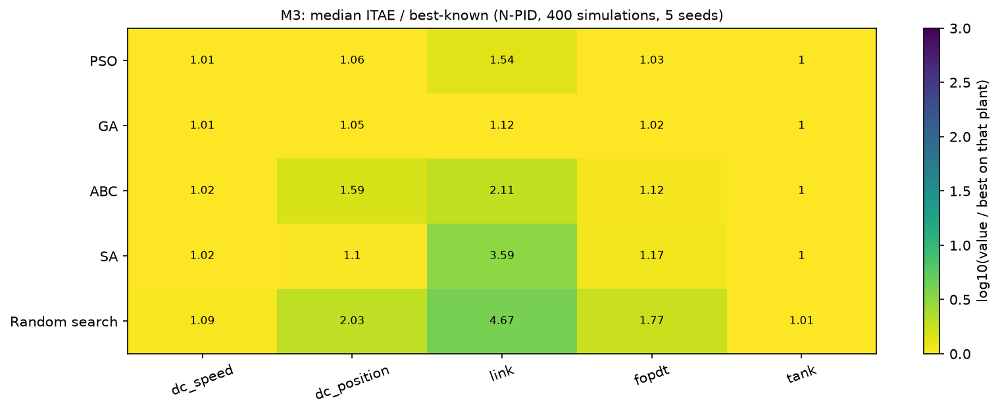
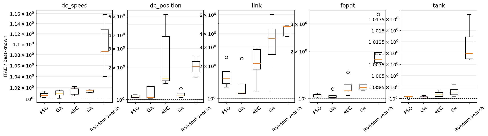
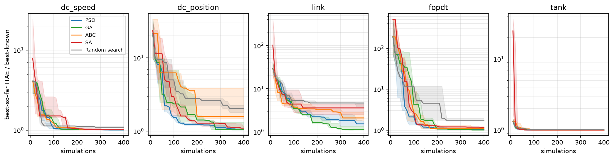
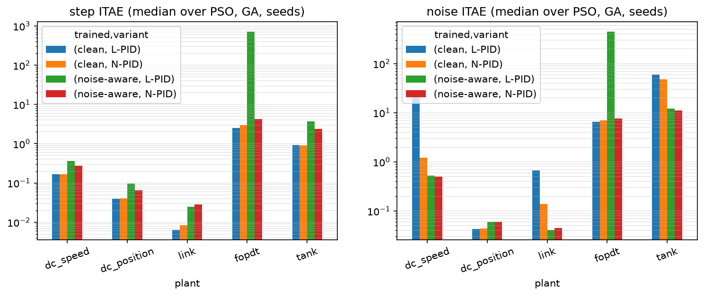

# M3 — Optimization-Based Tuning of the N-PID Controller (PSO, GA, ABC, SA)

*Phase M3 of `docs/METHODS_ROADMAP.md`; protocol `docs/PROTOCOL.md`; log `progress.md`. Code: `src/tuners/optimizers.py`, `src/tuners/reference.py`; experiments `experiments/m3a_best_known.py`, `experiments/m3_optimizers.py`; data `results/methods/M3/*.csv`, figures `results/methods/M3/figures/*.png`. M2 (self-tuning, model matching) is still pending; the phase order was changed so that M4–M6 can build on the optimizers.*

## 1. Summary

Four metaheuristics were implemented from scratch behind the common tuner interface and compared with a random-search baseline under an identical budget of 400 closed-loop simulations, 5 seeds, 5 plants, for the N-PID, for an L-PID tuned the same way, and for the N-PID with its shape exponents (n, m, p) also tuned. A best-known optimum per plant (grid search + long multi-start PSO + Nelder–Mead polish, 3 000–4 000 simulations each) was computed to measure the *gap* of every run.

1. **All four optimizers reach within 2% of the best-known optimum on the easy plants (`dc_speed` ≤ 1.7%, tank ≤ 0.1%), but only GA and PSO get within ~6% on `dc_position` and the dead-time plant (median gaps 1.02–1.06), and no optimizer gets within 5% on the gravity link at 400 simulations** (link median gap: GA 1.12, PSO 1.54, ABC 2.11, SA 3.59, random search 4.68).
2. **GA ≈ PSO > SA ≈ ABC > random search.** Of the 50 pairwise comparisons (per plant, Mann–Whitney, n = 5 per group) 28 are significant at p < 0.05; PSO wins 10, GA 9, SA 5, ABC 4, random search never. PSO and GA are never significantly different from each other.
3. **Random search is not far behind on easy plants** (`dc_speed` 8.6% gap, tank 1%): a plant with a flat cost landscape does not discriminate between optimizers, so benchmarking on it overstates algorithm differences by omission.
4. **The cost landscape is flat along ridges: the returned *gains* are poorly determined even when the *cost* is.** On `dc_speed` the cost varies 1.2% across seeds while Ki varies 81% and Kp 46%; the optimal gains lie on a Kp–Ki ridge (`M3_gain_scatter.png`). Gains cannot be compared across runs; only costs can.
5. **With ideal tuning the N-PID is not better than the L-PID on the clean step** (best-known: equal on `dc_speed`, link and tank within 0.5%; L-PID better by 15% on `dc_position` and 31% on the dead-time plant). Its measurable advantage is *noise*: tuned on the clean step it is 1.2–17× better under noise (3–17× on the three fast plants, e.g. `dc_speed` 1.27 vs 21.7) — but this advantage **disappears when the L-PID is also tuned for noise** (4 of 5 plants within 10%), except that noise-aware optimization of the L-PID on the dead-time plant failed in 5 of 10 runs (unstable gains), versus 0 of 10 for the N-PID.
6. **Tuning the shape exponents pays off on one plant out of five** (link: ITAE 2.1× better on step and noise) and is otherwise within ±6%; the tuned exponents are widely scattered, i.e. weakly identifiable.
7. **Noise-aware training trades clean performance for noise performance** (tank 47 → 11 under noise, 0.92 → 2.4–2.8 on the clean step), helps only where noise dominates the cost, and with a fixed number of noise realizations it can be exploited by the optimizer (finding 5).

## 2. Algorithms (all in `src/tuners/optimizers.py`, numpy only)

All algorithms are pure functions `algo(f, d, budget, rng) -> (u_best, f_best)` on the unit cube [0,1]^d, so they are validated on analytic functions independently of any plant. `Objective` maps the cube to the search space — log₁₀(Kp, Ki, Kd) inside the generic box of `default_bounds` (4–6 decades, protocol change P1), plus linear exponents n, m, p ∈ [0.5, 4] in the "+shape" variant (6-D) — and **enforces the budget in simulations** (so noise-averaged objectives are charged per simulation) with `BudgetExhausted`.

| algorithm | principle | default hyper-parameters (literature) | per-iteration cost |
|---|---|---|---|
| **PSO** (Kennedy–Eberhart 1995; Shi–Eberhart inertia schedule) | particles with velocity pulled to personal and global best: v ← w v + c₁r₁(p − x) + c₂r₂(g − x) | n = 20, w 0.9 → 0.4 linearly, c₁ = c₂ = 2, velocity clamp 0.2, global-best topology | n evaluations |
| **GA** (real-coded) | tournament selection (k = 3), BLX-α crossover (α = 0.5, p_c = 0.9), Gaussian mutation (p_m = 0.2, σ 0.15 → 0.01), elitism 2 | n = 20 | n − 2 evaluations |
| **ABC** (Karaboga 2005) | employed bees perturb one coordinate toward a random neighbour (greedy), onlookers choose sources by roulette on 1/(1 + f), scouts replace sources not improved for `limit` trials | 10 sources, limit = 0.5·d·SN | 2·SN evaluations |
| **SA** (Kirkpatrick 1983) | single chain, Gaussian neighbourhood σ₀·√(T/T₀), geometric cooling, Metropolis on log(1 + cost) differences (scale-free), T₀ calibrated for 50% uphill acceptance from 10 probes | σ₀ = 0.25, T_f/T₀ = 0.01 | 1 evaluation |
| Random search | uniform sampling | — | 1 evaluation |

**Generality.** The optimizers see only a `TuningProblem`; the box, the objective (ITAE of the step response, optionally averaged over noise seeds) and the controller kind are the only inputs. They apply unchanged to any simulable plant, including those with dead time and nonlinearity (the 5 benchmark plants).

## 3. Validation before evaluation (protocol section 9)

`tests/test_tuners_optimizers.py`, 25 tests, all passing:
- **Convergence**: each optimizer reaches a median of < 10⁻³ on a 3-D sphere in 400 evaluations (5 seeds); each beats random search (median over 7 seeds) on 3-D Rosenbrock at 600 evaluations; each reaches a median < 15 on 3-D Rastrigin (random points average ≈ 70).
- **Budget and determinism**: never more than the budget, ≥ 100 of 137 used, identical history for identical seeds, different for different seeds, best-so-far history non-increasing, never leaves the unit cube, survives a budget of 5 and a `FAIL_COST` plateau.
- **Plant wrapper**: cube-to-box mapping, simulation accounting (including 3 simulations per noise-averaged evaluation), shape variant, L-PID variant, bounds respected, reported training cost equals the best cost.
- **Independent cross-check**: the M1 reference PSO (pyswarms, different code and hyper-parameters) and the new PSO agree on the benchmark: median ITAE 0.169 vs 0.166 (`dc_speed`), 0.044 vs 0.041 (`dc_position`), 0.0093 vs 0.0095 (link), 3.13 vs 3.00 (dead-time), 0.921 vs 0.918 (tank).

## 4. Experimental setup

- Plants, scenarios, controller: as in the protocol; objective = ITAE of the clean step (4 s / 3 s / 2 s / 60 s horizons per plant).
- **Best-known optimum** (`best_known.csv`): for the 3-D variants, a 10³ log-space grid, three long PSO runs (800 evaluations each), then Nelder–Mead polish of the best three points (≈ 3 700–4 000 simulations); for the 6-D variant, the PSO route only (3 000 simulations). It is the best value *found*, not a proven global optimum: a gap of 1.00 means "as good as anything we found". Values: N-PID `dc_speed` 0.1647, `dc_position` 0.0391, link 0.00619, dead-time 2.897, tank 0.9172; L-PID 0.1643, 0.0330, 0.00631, 1.988, 0.9217; N-PID +shape 0.1647, 0.0373, 0.00619, 2.253, 0.9166.
- **Main benchmark**: 5 optimizers × 3 variants (N-PID, L-PID, N-PID +shape) × 5 plants × 5 seeds, 400 simulations; each tuned variant is evaluated with its own controller on step, disturbance and noise (10 seeds). **Budget sweep** 100/200/400/800 on `dc_speed`, `dc_position`, link (the fast plants). **Hyper-parameter sensitivity** (one-at-a-time, 3 values each) on `dc_speed` and link. **Noise-aware training** (objective averaged over 3 fixed noise seeds disjoint from the evaluation seeds; 400 simulations = 133 candidates) for PSO and GA, N-PID and L-PID.

## 5. Results

### 5.1 Gap to the best-known optimum (N-PID, 400 simulations; median over 5 seeds)

| algorithm | dc_speed | dc_position | link | dead-time | tank |
|---|---|---|---|---|---|
| PSO | 1.006 | 1.057 | 1.537 | 1.035 | 1.000 |
| GA | 1.010 | **1.047** | **1.123** | **1.020** | 1.000 |
| ABC | 1.017 | 1.588 | 2.109 | 1.117 | 1.001 |
| SA | 1.015 | 1.102 | 3.594 | 1.172 | 1.001 |
| Random search | 1.086 | 2.030 | 4.675 | 1.766 | 1.010 |

Worst seed (max gap): ABC 6.2 on `dc_position`, SA 6.0 on link, random search 4.7 on link, GA 2.3 and PSO 2.4 on link. Fraction of seeds within 5% (20%) of the optimum: `dc_speed` and tank 1.0 for all but random search (0.2 on `dc_speed`); `dc_position` GA 0.6 (0.6), PSO 0.4 (1.0), SA 0 (0.8), ABC 0 (0), random 0 (0); dead-time GA 0.8 (1.0), PSO 0.6 (1.0), ABC 0.2 (0.6), SA 0 (0.6), random 0 (0.2); link 0 for every optimizer within 5%; within 20% GA 0.6, ABC 0.2, SA 0.2, PSO 0, random 0.

### 5.2 Convergence

PSO descends fastest in the first 100 simulations on `dc_position` and the dead-time plant; GA is slower early but keeps improving and overtakes PSO on the link; SA is slowest early (hot start) and ABC stalls in plateaus (staircase curves: sources improve only after exhausting trials); random search flattens at 1.8–4.7× the optimum on the three non-trivial plants.

### 5.3 Statistics (`M3_pairwise.csv`)
Per plant and pair, Mann–Whitney U, n = 5 vs 5 (smallest attainable p = 0.008). 28 of 50 comparisons are significant; 22 are ties. Significant wins: PSO 10, GA 9, SA 5, ABC 4, random search 0. The tank gives only "tie vs random" differences of 1%. PSO vs GA: never significant. Seed counts are small, so ties should not be read as equality.

### 5.4 Budget sweep (median gap; `M3_budget_gap.csv`, `M3_budget_sweep.png`)

| plant | algorithm | 100 | 200 | 400 | 800 |
|---|---|---|---|---|---|
| dc_speed | PSO | 1.07 | 1.02 | 1.006 | 1.005 |
| dc_speed | GA | 1.26 | 1.015 | 1.010 | 1.013 |
| dc_position | PSO | 1.71 | 1.09 | 1.06 | 1.01 |
| dc_position | GA | 2.76 | 1.57 | 1.05 | 1.31 |
| link | PSO | 3.61 | 1.39 | 1.54 | 1.12 |
| link | GA | 6.15 | 2.65 | 1.12 | **1.02** |
| link | SA | 4.58 | 2.61 | 3.59 | 1.44 |
| link | ABC | 3.75 | 3.27 | 2.11 | 1.86 |
| link | random | 5.3 | 4.7 | 4.7 | 3.8 |

`dc_speed` is solved by 200 simulations; `dc_position` by 400 (PSO) to 800; the link needs ≥ 800 even for the best optimizers. Medians over 5 seeds are not monotone in the budget (PSO link 1.39 → 1.54, GA `dc_position` 1.05 → 1.31): the sampling noise of the medians is of the order of the differences between the better optimizers.

### 5.5 Hyper-parameter sensitivity (`M3_hyper_gap.csv`, `M3_hyper_sensitivity.png`)
`dc_speed` is insensitive (all medians 1.00–1.03, except SA σ₀ = 0.1: 1.095). The link is not: PSO with 10 particles reaches 1.13 against 1.54 for the default 20 and 1.57 for 40, c₁ = c₂ = 3 degrades it to 2.12; GA mutation probability 0.05 → 2.68, 0.2 → 1.12, 0.5 → 1.49, GA population 10 → 2.39, 40 → 1.34; ABC limit 2/8/40 → 2.61/2.82/1.89; SA σ₀ 0.1/0.25/0.5 → 2.32/3.59/1.62. On the hard plant, hyper-parameters change the median gap by up to 2–3×, comparable to the differences between algorithms: **the ranking of algorithms on the link is not robust to hyper-parameter choices** (the defaults were not tuned per algorithm). With 5 seeds the individual cells are noisy.

### 5.6 What does the nonlinearity add when both controllers are tuned equally? (RQ5)

Clean-step ITAE at the best-known optimum: N-PID vs L-PID — `dc_speed` 0.1647 vs 0.1643, link 0.00619 vs 0.00631, tank 0.9172 vs 0.9217 (N-PID 0.5% better), `dc_position` 0.0391 vs 0.0330 (L-PID 15% better), dead-time 2.897 vs 1.988 (L-PID 31% better). **At the optimum the nonlinear controller wins by at most 0.5% anywhere.**

Median ITAE reached at 400 simulations over the four optimizers and 5 seeds, each variant tuned by the same optimizers (`M3_rq5_variants.csv`):

| scenario | plant | L-PID | N-PID | N-PID +shape |
|---|---|---|---|---|
| step | dc_position | 0.0412 | 0.0496 | 0.0526 |
| step | link | **0.0064** | 0.0145 | 0.0070 |
| step | dead-time | 5.03 | **3.24** | 3.27 |
| noise (clean-trained) | dc_speed | 21.7 | **1.27** | 1.33 |
| noise (clean-trained) | link | 0.679 | 0.127 | **0.060** |
| noise (clean-trained) | dc_position | 0.159 | **0.051** | 0.054 |
| noise (clean-trained) | dead-time / tank | 8.28 / 60.1 | **7.00** / **47.3** | 6.85 / 47.3 |

(`dc_speed` and tank step: all three variants equal within 1%.) Two different things appear. (i) *At the optimum* L-PID ≥ N-PID; *at 400 simulations* the optimizers do better with the N-PID on the dead-time plant (3.24 vs 5.03) because the L-PID landscape is harder to search (gap to its own optimum 2.5×, against 1.1× for the N-PID). (ii) The N-PID is much more noise-tolerant when both are tuned on the clean step (3–17×).

**Fair noise comparison** — both controllers tuned for noise by the same optimizers (PSO and GA, `M3_rq5_noise_aware_fair.csv`), median noise-scenario ITAE:

| plant | L-PID noise-aware | N-PID noise-aware | L-PID clean-trained | N-PID clean-trained |
|---|---|---|---|---|
| dc_position | 0.060 | 0.061 | 0.043 | 0.044 |
| dc_speed | 0.520 | 0.503 | 21.7 | 1.21 |
| link | 0.0416 | 0.0455 | 0.675 | 0.138 |
| tank | 12.2 | 11.0 | 60.4 | 47.4 |
| dead-time | **451** | 7.71 | 6.48 | 7.04 |

Once the L-PID is also tuned for noise, **the N-PID's advantage disappears** (within 10% on four plants: the L-PID is 1% better on `dc_position`, 9% better on the link, 3% worse on `dc_speed` and 10% worse on the tank) — in agreement with the v2 finding on the DC speed loop. The shaping functions therefore act as a *built-in robustness mechanism* that a tuned linear PID can replicate, not as a source of a better optimum. The dead-time row is a failure of the optimization: 5 of the 10 L-PID noise-aware runs returned unstable gains (Ki 440–1 670, step ITAE 1 400–3 400), against 0 of 10 for the N-PID (step ITAE 3.3–12.2). A plausible but untested explanation is that with only three fixed noise realizations (133 candidate evaluations) the optimizer exploits those realizations on a landscape with a sharp stability boundary (L-PID), while the N-PID's bounded proportional action keeps the cost surface benign.

### 5.7 Shape exponents (`M3_shape_exponents.csv`, `M3_shape_exponents.png`)
Median tuned exponents (IQR) are close to the default 2 on most plants (n 1.76–2.68, m 1.71–2.98, p 0.88–2.53) but the interquartile ranges are wide (n on `dc_speed` 0.95–3.25) and on the link p tends to 0.88 (IQR 0.5–1.17). At the best-known optimum shape tuning improves the dead-time plant by 22% (2.253 vs 2.897) and `dc_position` by 4.6%; at 400 simulations it helps the link by 2.1× (step and noise). The exponents are only weakly identifiable, and the 6-D search costs more evaluations for a gain that is plant-dependent.

### 5.8 Noise-aware training (N-PID; `M3_noise_aware_table.csv`)

| plant | step, clean-trained (PSO) | step, noise-aware | noise, clean-trained | noise, noise-aware |
|---|---|---|---|---|
| dc_speed | 0.166 | 0.274 | 1.18 | **0.447** |
| link | 0.0095 | 0.0278 | 0.101 | **0.042** |
| tank | 0.918 | 2.76 | 47.5 | **11.0** |
| dc_position | 0.041 | 0.057 | **0.044** | 0.058 |
| dead-time | 3.00 | 3.98 | **7.11** | 7.32 |

Noise-aware training lowers the noise ITAE by 2.6× (`dc_speed`), 2.4× (link) and 4.3× (tank), at the price of a worse clean step (1.6–3×); it does nothing or hurts on `dc_position` and the dead-time plant. It is also handicapped by its budget (133 candidates against 400).

### 5.9 Identifiability (`M3_identifiability.csv`, `M3_gain_scatter.png`)
Coefficient of variation across seeds (mean over optimizers): cost 1.2% / 0.1% (`dc_speed` / tank), 14% (dead-time), 23% (`dc_position`), 33% (link); gains: Kp 12–75%, Ki 10–122%, Kd 37–92%. On `dc_speed`, tank and link the solutions lie along Kp–Ki ridges. The dataset-labelling plan of M4 must therefore avoid treating a single PSO gain triple as "the" optimal gains.

## 6. Analysis

**RQ1 (performance).** GA and PSO are the best optimizers here and are indistinguishable at 400 simulations; ABC and SA are significantly worse on some plants (ABC `dc_position`, SA link and dead-time) and have heavy-tail failures (gap up to 6×); random search is 1.8–4.7× from the optimum on the three non-trivial plants. All optimizers outperform classical rules in clean ITAE (M1), for a cost of 800–24 000 simulated seconds.
**RQ2 (cost).** Wall time is dominated by simulation (per-run medians 51 s GA to 59 s random search across plants); the optimizers' own overhead is negligible. Budget needed: ~200 simulations for easy plants, ≥ 800 for the link.
**RQ3 (generality).** Applicable to every plant and controller variant without modification — the main advantage over classical methods (M1: 9 of 45 pairs not applicable) — but the quality varies strongly with the plant landscape: flat (tank, `dc_speed`: any optimizer works), ridge-like (`dc_position`, dead-time), rugged (link).
**RQ4 (robustness).** Gains optimized on the clean step are noise-fragile (M1, M3: up to 51×); noise-aware training repairs this where noise dominates, at the cost of the clean step and with a risk of exploiting the fixed noise realizations.
**RQ5 (nonlinearity).** The N-PID adds little at the optimum and its apparent noise advantage is replicated by a noise-tuned L-PID; shaping exponents help on one plant out of five.

### Pros and cons

| method | pros | cons | observed failure modes |
|---|---|---|---|
| PSO | fastest early convergence, robust defaults on 4/5 plants | sensitive to swarm size and acceleration constants on the link (gap 1.13–2.12) | stagnation on the link (gap 1.5–2.4) |
| GA | best late convergence and best results on the harder plants (link 1.12 at 400, 1.02 at 800), smallest worst-case gap | needs a larger budget than PSO to catch up; sensitive to mutation rate and population (link) | slow first 100 simulations |
| ABC | few hyper-parameters, simple | plateaus and heavy tails; weakest on `dc_position` (median 1.59, worst 6.2) | long stalls until scouts trigger |
| SA | one candidate per iteration, trivial memory, can cool slowly | needs a good neighbourhood scale (link gap 1.6–3.6 across σ₀), slow start, single chain | worst seeds on the link (gap 6) |
| Random search | no tuning, trivially parallel | 1.8–4.7× from the optimum on the non-trivial plants | — (it is the baseline) |

## 7. Errors, caveats and lessons (kept for transparency)
1. **Protocol change P1 (previous phase) was essential**: with the original narrow box the reference PSO could not reach the tank optimum; M3 runs use the corrected wide box.
2. The budget wrapper was designed to charge simulations rather than objective calls from the start (a noise-averaged evaluation costs 3), and has a test (`test_objective_with_shape_and_noise_budget_accounting`); no accounting bug occurred.
3. Test errors only (a result attribute name; an always-true assertion); no implementation bug was found by the tests.
4. **Medians of 5 seeds are noisy** (non-monotone budget curves, hyper-parameter cells); conclusions are therefore stated only where they exceed the seed spread or are supported by the Mann–Whitney test.
5. The best-known optimum is a lower bound on the true optimum: for the link, where no optimizer gets within 5%, the true gaps may be larger.
6. Noise-aware runs have a 3× smaller candidate budget; the fixed noise seeds can be exploited (see 5.6).
7. Hyper-parameters were the literature defaults, not tuned per plant; ranking on the link depends on them (5.5).

## 8. Limitations
Five plants, one setpoint each; ITAE on one clean step as objective (a different objective — e.g. IAE, overshoot-penalised — changes the landscape); 5 seeds; no parallelism study; the budget sweep covers only the fast plants; the L-PID and the +shape variants use the same box and budget as the N-PID (the 6-D search would deserve a larger budget).

## 9. Consequences for the next phases
- **M4/M5 (ML, hybrid)**: use GA or PSO with ≥ 400 simulations and several restarts to label data, keep the *cost* (not the gains) as the quality criterion, and add a "constant gains" baseline; labels along a ridge are ambiguous — train on the cost-weighted solution set or report regret, not gain error.
- **M6 (adaptive)**: warm-starting is valuable because 200–800 simulations are needed to reach the optimum from scratch.
- **M7**: the benchmark must report optimizer results as distributions (median, worst) rather than best-of-n, and must include the L-PID tuned by the same method.
