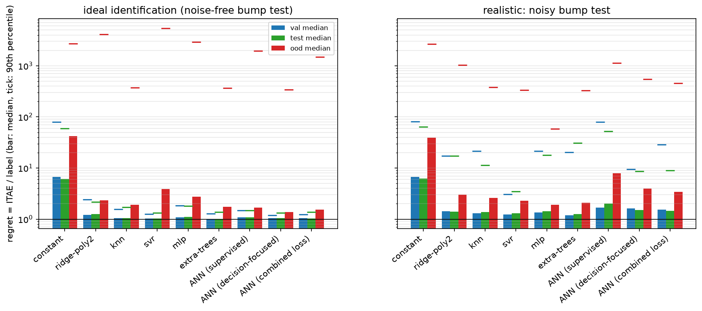
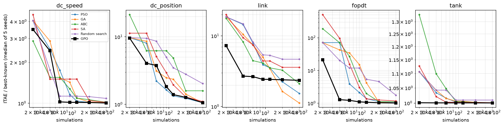
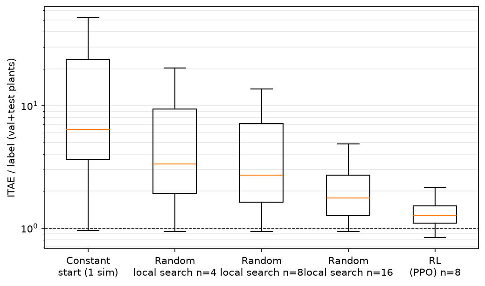

# M4 — ML-Based Tuning of the N-PID Controller (Regression SVR/NN, ANN, Gaussian-Process Optimisation, Reinforcement Learning)

*Phase M4 of `docs/METHODS_ROADMAP.md`; protocol `docs/PROTOCOL.md`; log `progress.md`. Code: `src/plant_family.py`, `src/tuners/features.py`, `src/tuners/ml.py`, `src/tuners/rl.py`; experiments `experiments/m4a_dataset.py`, `m4b_supervised.py`, `m4c_bayesopt.py`, `m4d_rl.py`, `m4_analyze.py`; data `data/m4/` (not versioned: 1 350 labelled plants), results `results/methods/M4/`; tests `tests/test_plant_family.py` (13), `test_tuners_features.py` (8), `test_tuners_ml.py` (15), `test_tuners_rl.py` (6).*

> **Status.** Complete: data, regression, ANN, Gaussian-process optimisation, reinforcement learning, label-quality calibration. Tests: `tests/test_tuners_rl.py` (6) cover the RL environment and tuners.

## 1. Summary

1. **A plant-agnostic dataset was built from scratch**: 1 350 randomised plants of six structures (first order, second order, integrating, nonlinear (Hammerstein) in training; underdamped and third order held out), gain and time scale varying over two decades, each labelled by the best of GA and PSO (400 simulations each). All 762 evaluations per plant are kept (1.03 M labelled closed-loop runs), which makes a learned cost surrogate possible.
2. **Dimensionless gains + a bump test make tuning transferable across scales.** The model predicts K_p K_eff, K_i K_eff T_n, K_d K_eff/T_n from 8 dimensionless features of one bump test (3 experiments on median, 2.9 closed-loop horizons of simulated time). Without normalisation the regret is worse (median 1.29 vs 1.23, noisy protocol; 1.11 vs 1.02 clean).
3. **Under ideal identification the learned tuners are excellent: median regret 1.01–1.04** (extra-trees 1.009/1.014, SVR 1.022/1.038, ANN 1.039 on val/test) against **6.1–6.7 for a single constant normalised gain set**; 93–97% of test plants within 1.5× of the label. This contrasts with the DC-motor study (v2), where a constant gain set was already within 3%: with plants of different *structure* the mapping has real content.
4. **That result is not robust to measurement noise during the bump test.** The same models fed with features measured under realistic noise (the plant's own 0.5–2% sensor noise) collapse (median regret 80 for SVR, 79 for the ANN, 2.6 for extra-trees), although K_eff and T_n are identified to within a few percent. **Training on noisy features removes the brittleness** at a price: realistic-protocol median regret 1.19–1.30 (val/test) for SVR and extra-trees, 90th percentile 3 (SVR) to 20–31 (extra-trees). The realistic numbers are the primary ones.
5. **SVR is the most reliable learned tuner under noise** (90th percentile 3.0–3.5 vs 20–80 for the others); extra-trees has the lowest median; the ANN is worse under noise (median 1.5–1.7) — its advantage from a *decision-focused loss through a learned cost surrogate* is clear with clean features (OOD median 1.39 vs 1.68 supervised) but disappears with noisy ones.
6. **Unseen plant structures are the limit**: out of distribution the median regret is 1.9–3.0 for the non-ANN models (ANN 3.4–7.9) in the realistic protocol and the 90th percentile 59–1 135; for the underdamped plants every learned model of section 5.2 has a median regret of 13–21 (a first-order bump-test model cannot see the ringing), while third-order plants are tolerable (1.3–1.7).
7. **Gaussian-process optimisation is the most sample-efficient tuner of the whole study** (the one to use when ≈ 60 simulations are affordable): median regret 1.20 at 60 simulations on 60 plants of the family vs 1.71 (PSO), 2.36 (GA), 3.04 (random search); on four of the five benchmark plants it is the best method at 60 simulations; **it stalls on the rugged gravity link** (gap 2.35 at 400 simulations vs 1.12 for GA).
8. **Reinforcement learning as a learned local search is the best tuner under realistic conditions when ≈ 11 simulations are affordable**: a PPO agent with a budget of 8 closed-loop simulations (plus the bump test) reaches median regret 1.24 / 1.27 on val / test plants with a 90th percentile of 1.9 / 2.1 — against 2.9 / 2.6 (90th percentile 36 / 30) for a random local search with the *same* 8 simulations, and 1.67 / 1.86 for the random search with 16. Out of distribution its tail is far better than the regressors' (90th percentile 5.0 vs 333 for SVR; 3.8% of plants worse than 10× vs 61% for the constant start). This reverses the negative RL result of the legacy project, whose agent adapted gains online under a drift that needed no adaptation.
9. **The labels are good enough to measure regret**: against a 3 000-simulation search on 48 test plants the label is within 0.7% (median), 5% (90th percentile), worst case 1.92×.

## 2. Data and features

### 2.1 Plant family (`src/plant_family.py`, 13 tests)
Six structures, every plant positive-gain, stable or integrating, with a reachable setpoint by construction: FOPDT, SOPDT (overdamped), IPDT, Hammerstein (FOPDT behind sign(u)|u|^p, p ∈ [0.5, 0.8]) for training; underdamped (ζ ∈ [0.25, 0.7]) and third-order for the held-out set. Randomised: gain (log-uniform 0.3–5), time scale (0.2–20 s), dead-time ratio (0.03–1.5, or none for 10%), setpoint (0.5–30), actuator authority 1.8–10× the steady-state need, unipolar or symmetric actuator, input disturbance (5–20% of the steady input), measurement noise (0.5–2% of the setpoint). `LTIPlant` integrates the linear dynamics exactly (ZOH discretisation, cached per step), validated against the RK4 plants to 10⁻⁶ and ≥ 2× faster; one closed-loop simulation takes ≈ 35 ms (1 500 steps).

### 2.2 Features and normalisation (`src/tuners/features.py`, 8 tests)
A counted bump test (`identify_process`, M0) gives a local model and the unit-step response. Features (all dimensionless): integrating flag, dead-time fraction θ/(τ+θ) and its log, log₁₀ of the actuator authority u_max K_eff/|y_ref|, unipolar flag, log₁₀ of the fit error, peak ratio of the step response (ringing), t₆₃/T_n; plus a 24-point normalised step-response signature. With K_eff = K (or K_v T_n for integrators) and T_n = τ + θ the gains are normalised as Kp·K_eff, Ki·K_eff·T_n, Kd·K_eff/T_n. Tests: features invariant to plant gain and time scale; normalised optimum transfers between plants scaled consistently (the response of the rescaled loop coincides within 0.06); exact FOPDT features equal the textbook values; round trips.

### 2.3 Dataset (`experiments/m4a_dataset.py`, 68 min on 12 workers)
1 350 plants: 840 train / 180 val / 180 test (training structures, split by a hash of the plant index) and 150 out-of-distribution (75 underdamped, 75 third order). Per plant: features, the label (best of GA and PSO at 400 simulations each), and all 762 recorded evaluations (normalised gains, log₁₀ normalised cost). PSO produced the better label for 59% of the plants, GA for 41%. **The two labellers disagree**: the worse/better cost ratio is 1.03 at the median, 1.40 at the 90th percentile and up to 287 (a catastrophic failure of one labeller), which is why the label is the best of both.

## 3. Methods

### 3.1 Regression models (SVR / NN) — method 12
Supervised regression from the engineered features to the label z (3 outputs): constant (median label — the no-learning baseline), ridge with degree-2 features, k-nearest neighbours (k = 7, distance-weighted), **RBF SVR** (one regressor per output; C, γ, ε chosen by 4-fold inner cross-validation), MLP (64, 32), extra-trees (300). Applied through `SupervisedTuner`: bump test → features → prediction → de-normalised gains clipped to the generic box. Tuning cost: the bump test (median 3 experiments) plus the prediction: SVR 2.9 ms, MLP 0.9 ms, extra-trees 67 ms (300 trees, single thread), ANN ensemble 1.4 ms.

### 3.2 ANN with a task-level loss — method 15
`ANNPolicy`: an ensemble of 5 MLPs (64, 64) with a sigmoid output confined to the data range. Two training signals: **(a) supervised** (squared error to the label) and **(b) decision-focused**: a surrogate network S(x, z) ≈ log₁₀ (cost − plant minimum) is trained on all ≈ 640 k recorded (plant, gains, cost) triples, then the policy is trained to minimise S(x, π(x)) *without* seeing the label; (c) combined (0.3·supervised + decision). A synthetic test with an exact bowl-shaped cost verifies that (b) alone finds the optimum (error below 0.6× that of random points, the test threshold). The ANN uses the normalised step-response signature (24 points + 3 flags) by default; it differs from method 12 by the raw input and by the task-level loss.

### 3.3 Gaussian-process (Bayesian) optimisation — method 14
`BayesOptTuner`: Matérn-5/2 ARD kernel plus noise on log₁₀ ITAE, expected improvement maximised over 2 000 random candidates plus 400 local perturbations of the three best points, 8 Latin-hypercube start points, hyper-parameters re-fitted every 5 evaluations (L-BFGS, 1 restart at the first fit). Divergent runs are damped (cost capped at 10³× the best). Tests: respects the budget, deterministic per seed, beats random search on an analytic cost, exactly keeps a warm-start optimum.

### 3.4 Reinforcement learning — method 13
A PPO agent as a **learned local search** over the normalised log-gains (`src/tuners/rl.py`, `TuningEnv`). A session on one plant has a budget of 8 closed-loop simulations: simulation 1 evaluates the start point (the median label of the training plants — a constant, plant-independent start), simulations 2–8 evaluate points proposed by the agent as a change Δz = 0.4·a, a ∈ [−1, 1]³, of the current point. Observation (17 values): the 8 dimensionless features, the current point (normalised to the data range), the improvement of the last and of the best point over the start, the shape of the last response (overshoot, final error, rise time/T_n) and the fraction of the budget used. Reward: improvement of the best log₁₀ cost so far (non-negative, so exploration is not punished). Algorithm: PPO (stable-baselines3), MLP policy (128, 128), 4 vectorised environments per seed, 120 000 steps, 3 seeds; each reset draws a training plant. Deployment (`RLTuner`) runs the same session with deterministic actions and returns the best point found; the cost is the bump test plus 8 simulations. **Baselines at the same budget**: `RandomLocalSearch` (same start, Gaussian steps from the best point so far, 4 / 8 / 16 simulations) and `ConstantStart` (1 simulation). Why this design instead of the legacy online gain adaptation: an agent that adapts gains during operation needs a plant that drifts; here the question is whether a *learned* search policy beats a generic one at equal cost.

## 4. Protocol and metrics
Regret of a plant = ITAE(method) / ITAE(label), both on the clean step with the N-PID (the label is the best of 800 simulations, not the true optimum, so regret < 1 is possible). Median, 90th percentile, fraction within 1.5× and within 1.1×; evaluation on val, test and the held-out structures (ood). **Two feature protocols**: *ideal* (noise-free bump test, upper bound) and *realistic* (bump test with the plant's own measurement noise, the primary protocol; labels re-expressed in the noisy normalisation constants by an exact log-space shift, tested). Regression models are trained on the train split only; hyper-parameters of the SVR by inner cross-validation on the train split.

## 5. Results: regression and ANN

### 5.1 Median regret (90th percentile in brackets)

**Realistic protocol (noisy bump test)**

| model | val | test | ood |
|---|---|---|---|
| constant (no learning) | 6.71 (81) | 6.27 (64) | 39.0 (2 641) |
| ridge, degree 2 | 1.42 (17) | 1.40 (17) | 3.02 (1 040) |
| k-NN | 1.31 (21) | 1.37 (11) | 2.61 (379) |
| **SVR** | 1.23 (**3.0**) | **1.30 (3.5)** | 2.28 (333) |
| MLP | 1.36 (22) | 1.42 (18) | **1.92 (59)** |
| extra-trees | **1.19** (21) | 1.27 (31) | 2.11 (327) |
| ANN supervised | 1.70 (79) | 2.03 (52) | 7.90 (1 135) |
| ANN decision-focused | 1.61 (9.4) | 1.51 (8.6) | 3.98 (550) |
| ANN combined | 1.55 (29) | 1.45 (9.0) | 3.41 (455) |

Within 1.5× of the label (val / test / ood): SVR 63 / 65 / 27%, extra-trees 63 / 57 / 33%, ANN combined 48 / 52 / 19%, constant 0.6 / 0.6 / 0%.

**Ideal protocol (noise-free bump test, upper bound)**

| model | val | test | ood |
|---|---|---|---|
| constant | 6.74 (80) | 6.14 (59) | 42.4 (2 720) |
| ridge | 1.22 (2.4) | 1.25 (2.2) | 2.34 (4 103) |
| k-NN | 1.045 (1.6) | 1.057 (1.7) | 1.92 (374) |
| SVR | 1.022 (1.25) | 1.038 (1.34) | 3.88 (5 407) |
| MLP | 1.092 (1.8) | 1.109 (1.8) | 2.76 (2 916) |
| extra-trees | **1.009** (1.27) | **1.014** (1.37) | 1.73 (366) |
| ANN supervised | 1.079 (1.49) | 1.089 (1.48) | 1.68 (1 968) |
| ANN decision-focused | 1.045 (**1.20**) | 1.053 (**1.33**) | **1.39 (339)** |
| ANN combined | 1.039 (1.24) | 1.038 (1.39) | 1.53 (1 490) |

### 5.2 By plant structure (realistic protocol, median regret over all splits)

| model | fopdt | hammerstein | ipdt | sopdt | third (ood) | underdamped (ood) |
|---|---|---|---|---|---|---|
| constant | 11.7 | 4.07 | 5.72 | 8.56 | 4.37 | 1 083 |
| SVR | 1.31 | 1.41 | 1.20 | 1.22 | 1.44 | 14.3 |
| extra-trees | 1.40 | 1.30 | 1.18 | 1.23 | 1.34 | 14.4 |
| ANN decision-focused | 1.69 | 2.11 | 1.17 | 1.64 | 1.64 | 21.3 |
| ANN combined | 1.68 | 2.20 | 1.14 | 1.64 | 1.67 | 12.8 |

Integrating plants are the easiest (1.14–1.20), nonlinear Hammerstein and dead-time plants somewhat harder; **underdamped plants fail for every learned model** (13–21): the first-order bump-test model misses the ringing, the peak-ratio feature is not enough, and the labels there are also the least reliable (GA/PSO disagree most, see 2.3).

### 5.3 Closed-loop robustness of the predicted gains (`M4_final_summary*.csv`; ratio to the label's own result)
Realistic protocol, test plants: SVR step / disturbance / noise ITAE ratio 1.30 / 1.14 / 1.11 (MLP 1.42 / 1.21 / 1.23; ANN 1.45 / 1.35 / 1.19; constant 6.27 / 5.45 / 2.78); held-out structures: SVR 2.28 / 1.80 / 1.35, constant 39 / 15.8 / 22.8. Ideal protocol, test: SVR 1.04 / 1.01 / 1.02. The gains predicted for the clean step are as robust to disturbance and measurement noise as the labelled ones.

## 6. Ablations

### 6.1 Noise in the bump test: the most important finding (`M4_noisy_features.csv`, `M4_noise_robust.csv`; validation plants)
| models trained on → tested on | SVR | extra-trees | ANN |
|---|---|---|---|
| clean → clean | 1.02 | 1.01 | 1.04 |
| **clean → noisy** | **79.8** | 2.59 | **78.7** |
| noisy → noisy | 1.22 (p90 2.9) | 1.21 (p90 18.5) | 1.49 (p90 9.6) |
| noisy → clean | 1.69 (p90 103) | 2.22 (p90 43) | 1.15 |

For SVR and ANN the clean-trained models are unusable when features come from a noisy bump test (median 79–80) although the identified K_eff and T_n are within 1–5% of the clean ones on 11 of 12 inspected plants (27% on one Hammerstein plant). Removing the fit-error feature (which moves out of its training range under noise) helps only partly (SVR 36.6). A direct sweep of the bump-test noise (0.5/1/2/5% of the setpoint) shows the collapse already at 0.5% (SVR 63, ANN 78, extra-trees 1.19) and that extra-trees degrades more gracefully (1.3 at 1%, 7.1 at 2%, 22.6 at 5%). The cause is a train/test mismatch of the input distribution, not an identification failure; the remedy (train on noisy features) costs about 20% in median regret but keeps the tail within a factor 3 for SVR.

### 6.2 Realistic protocol, other ablations (`M4_ablations_noisy.csv`; validation plants)
- **Training-set size** (SVR / ANN median regret): 50 → 2.43 / 2.35, 100 → 1.39 / 1.83, 200 → 1.42 / 1.54, 400 → 1.25 / 1.53, 840 → 1.23 / 1.55. The SVR flattens after ≈ 400 plants; the ANN does not improve beyond 200.
- **Feature set** (SVR): engineered 1.23, signature 1.64, both 1.25, no normalisation 1.29 → the 8 engineered features carry the information; the raw signature adds noise; normalisation gives ≈ 5% (ideal protocol: 1.11 vs 1.02, 9%).
- **Label variant** (SVR): best 1.23, mean of the best 5% evaluations 1.27, best 1% 1.24 → smoothing the label along the ridge of near-optimal gains does not help.
- **ANN loss**: supervised 1.70, decision-focused 1.61, combined 1.55; **ANN features**: engineered 1.25, signature 1.55, both 1.29. Under noise the engineered features are better for the ANN as well.
- **Feature perturbation at inference** (noisy-trained SVR, multiplicative noise): 5% → 1.26, 10% → 1.43, 20% → 1.89 (the clean-trained model: 1.49, 2.79, 13.4).
Ideal protocol (`M4_ablations.csv`): learning curve SVR 1.39 → 1.02 (50 → 840 plants); feature sets engineered 1.022, signature 1.014, both 1.008; ANN loss 1.079 / 1.045 / 1.039; ANN features 1.055 / 1.039 / 1.025.

## 7. Gaussian-process optimisation (`experiments/m4c_bayesopt.py`; `M4_gpo_*.csv`)

### 7.1 Benchmark plants — gap to the best-known optimum (median of 5 seeds)

| plant | method | 20 | 40 | 60 | 120 | 200 | 400 |
|---|---|---|---|---|---|---|---|
| dc_speed | GPO | 3.49 | 2.44 | **1.02** | 1.02 | 1.01 | 1.005 |
| | GA / PSO | 4.07 | 2.87 / 2.51 | 1.54 / 1.75 | 1.10 / 1.04 | 1.02 | 1.01 |
| dc_position | GPO | 9.6 | 4.1 | 3.77 | 1.39 | 1.27 | 1.06 |
| | GA / PSO | 9.8 | 8.6 / 8.1 | 3.12 / **2.22** | 2.35 / 1.33 | 1.42 / 1.23 | 1.05 / 1.06 |
| link | GPO | 7.3 | 2.70 | **2.65** | 2.42 | 2.39 | **2.35** |
| | GA / PSO | 18.6 | 10.5 / 14.5 | 7.5 / 7.9 | 3.45 / 3.54 | 1.64 / 2.24 | **1.12** / 1.54 |
| dead-time | GPO | 21.2 | 1.28 | **1.22** | 1.07 | 1.03 | 1.014 |
| | GA / PSO | 71 | 42 / 71 | 34.5 / 3.9 | 4.2 / 1.37 | 1.08 / 1.11 | 1.02 / 1.04 |
| tank | GPO | **1.001** | 1.001 | 1.001 | 1.001 | 1.001 | 1.001 |
| | GA / PSO | 1.11 | 1.04 | 1.015 | 1.006 / 1.002 | 1.002 | 1.000 |

### 7.2 Plants of the family (60 val+test plants, regret to the label; `M4_gpo_family_median_regret.csv`)

| simulations | 20 | 40 | 60 | 90 | 120 |
|---|---|---|---|---|---|
| GPO | **2.45** | **1.35** | **1.20** | **1.09** | **1.03** |
| PSO | 18.3 | 3.09 | 1.71 | 1.28 | 1.15 |
| GA | 18.3 | 5.93 | 2.36 | 1.54 | 1.27 |
| random search | 18.3 | 5.03 | 3.04 | 3.04 | 2.63 |

(the first 20 evaluations of GA/PSO/random search are one random population, which is why the three coincide at 20.) 90th-percentile regret at 60 simulations: GPO 1.85 vs PSO 3.9, GA 12.5, random 11.4; at 120: 1.27 vs 1.52, 5.2, 6.7. At 60 simulations GPO beats GA on 88% of the plants, PSO on 80%, random search on 95%.

### 7.3 Diagnostics
The fitted ARD length scales (in the unit cube of log-gains) show which gain matters: on the dead-time plant K_d is the least informative (length scale 0.38–0.69 vs 0.08–0.12 for K_p and K_i), on the link K_i (0.61–0.91); on `dc_position` at 400 simulations the length scales of K_p and K_d reach the lower bound of the fit (0.03, 0.05), the signature of a rugged cost surface that a stationary smooth GP cannot model — consistent with the stall on the link. Training RMSE of the normalised surrogate: ≤ 0.12 at 60 simulations, ≤ 0.034 at 400.

### 7.4 Pros and cons
Pros: about half the simulations of PSO and GA for the same median regret on the family (GPO 1.20 at 60 simulations; PSO needs ≈ 105, GA ≈ 140), far fewer than random search, and 20–60 evaluations suffice on the smooth benchmark plants; works with no prior knowledge, no dataset and no training; warm-startable. Cons: stalls on rugged or discontinuous landscapes (link, `dc_position` at 60 simulations); the GP cost grows cubically with the number of evaluations (fits every 5 evaluations keep it manageable up to 400); a stationary kernel assumption.

## 8. Reinforcement learning (`experiments/m4d_rl.py`; `M4_rl_*.csv`, `M4_rl_regret.png`)

Evaluation: 510 plants (180 val, 180 test, 150 held-out structures), the three PPO seeds against the baselines of section 3.4, regret against the label (clean-step ITAE of the N-PID), 4 noise seeds for the secondary scenarios.

| method (simulations after the bump test) | val median (p90) | test median (p90) | ood median (p90) | within 1.5× (val / test / ood) | worse than 10× (val / test / ood) |
|---|---|---|---|---|---|
| constant start (1) | 6.74 (80) | 6.14 (59) | 42.4 (2 720) | 1 / 1 / 0% | 41 / 35 / 61% |
| random local search (4) | 3.44 (53) | 3.26 (39) | 19.9 (2 100) | 14 / 13 / 1% | 28 / 22 / 55% |
| random local search (8) | 2.90 (36) | 2.56 (30) | 16.1 (1 365) | 23 / 22 / 1% | 23 / 19 / 55% |
| random local search (16) | 1.67 (4.4) | 1.86 (4.5) | 2.16 (7.5) | 39 / 36 / 8% | 1 / 2 / 7% |
| **RL (PPO), 3 seeds pooled (8)** | **1.24 (1.85)** | **1.27 (2.08)** | **1.86 (4.98)** | **75 / 73 / 30%** | **0 / 0 / 4%** |
| *SVR, realistic features (0)* | *1.23 (3.0)* | *1.30 (3.5)* | *2.28 (333)* | *63 / 65 / 27%* | — |

Per seed (median val / test / ood): seed 0: 1.19 / 1.24 / 1.54; seed 1: 1.33 / 1.37 / 2.15; seed 2: 1.24 / 1.24 / 1.89 — the seed-to-seed spread is 12% in distribution and 40% out of it. Paired over plants, each seed beats the random local search with the same 8 simulations on 94 / 82 / 88% of the plants and the constant start on 99%; a random local search beats the constant start on 97% of the plants. Median improvement over the constant start: 1.55× (random, 4 simulations), 1.95× (random, 8), 3.5× (random, 16), **5.7× (RL, 8)**.

**Reading.** The learned search policy is worth about eight additional random simulations (RL with 8 ≈ better than random with 16 on the median and the 90th percentile); it matches the SVR median while removing its heavy tail (the 90th percentile of the SVR out of distribution is 333, of RL 5.0), because it *measures* the closed loop instead of extrapolating from features. The price is 8 closed-loop simulations (each a full horizon) in addition to the bump test, i.e. roughly 11 simulations against SVR's 3 experiments. A budget-matched comparison with Gaussian-process optimisation (section 7.2: median regret 1.20 at 60 simulations, 2.45 at 20) shows RL (1.24 at 8 simulations) needs about 7× fewer simulations than GPO (1.20 at 60) for a similar median, because it carries prior knowledge learned from 840 plants (the two were measured on different plant sets: 60 val+test plants for GPO, all 510 for RL).

**Pros**: tiny search budget; learned prior over plant families; robust tail out of distribution; no label noise in the loss (it optimises the real objective). **Cons**: needs a training distribution of plants and ≈ 83 minutes of training per seed here (multi-threaded learners; ≈ 30–40 min estimated for single-threaded ones); seed variance (40% out of distribution); the policy is tied to the 8-simulation budget and the step size it was trained with (no budget or step-size ablation was run); results are for the clean-step ITAE objective.
**Caveat**: the sessions were run with features from a noise-free bump test (training and evaluation), and the simulations inside a session are noise-free; its robustness to a noisy bump test, which broke the regressors (section 6.1), was *not* tested — the agent's use of simulated responses suggests it should depend less on the features, but this is a hypothesis.

## 9. Label quality (`experiments/m4e_label_quality.py`, `M4_label_quality.csv`)

The regret above is measured against the label (best of GA and PSO, 400 simulations each). A long search (GA and PSO, 1 500 simulations each, new seeds) on 48 test plants gives: label cost / long-search cost = **1.007 (median)**, mean 1.050, 90th percentile 1.052, maximum 1.92; the label is better than the long search for only 4% of the plants. By structure (median): FOPDT 1.005, integrating 1.002, Hammerstein 1.013, second order 1.033. So the labels are within 5% of a 3 000-simulation optimum for 90% of the plants, and regret values below ≈ 1.05 cannot be distinguished from the label's own error; the worst-label plants (one at 1.92) inflate nothing systematically but make the largest regrets slightly optimistic.

## 10. Pros and cons

| method | pros | cons | failure modes seen |
|---|---|---|---|
| Regression (SVR) | one bump test (median 3 experiments) + 3 ms; median regret 1.2–1.3 and 90th percentile 3 under realistic noise; trains in seconds | needs a labelled dataset of ≈ 400+ plants; breaks on unseen structures (median 2.3, tail ≫ 100) | clean-trained: collapse under noisy features (median 80) |
| Extra-trees | lowest median (1.19–1.27) | heavy tail (p90 20–31), 67 ms inference, ranks below SVR in reliability | underdamped plants |
| MLP / ridge / k-NN | simple; MLP best OOD median (1.92) | tails 11–22 | — |
| ANN (decision-focused) | uses the full landscape; best ideal OOD (1.39); sample-efficient in small data | surrogate exploitable; not better than SVR under noise | noisy signatures (1.5–1.7) |
| GPO | most sample-efficient method without training data; no dataset | stalls on rugged landscapes; cubic cost | link (2.35 at 400) |
| RL (PPO learned local search) | best tail; 8 simulations after the bump test reach median regret 1.24–1.27, p90 ≈ 2; learned prior | needs training plants and ≈ 83 min per seed; seed spread 12–40%; tied to the trained budget; not tested with noisy features | OOD median 1.86 (p90 5.0) |

## 11. Errors found and corrected during development
1. **Clean-only features**: the first full evaluation reported excellent regret (1.01–1.04) for models fed with noise-free bump-test features; testing with a noisy bump test revealed the collapse (median 80). The study was re-run with a realistic protocol (training and testing on noisy features) and both are reported. Training on clean features while deploying on noisy plants would have been a serious, silent flaw.
2. **`MLPRegressor` positional argument**: in this scikit-learn version the first positional argument is the loss, not the layer sizes; found by a unit test, fixed with a keyword.
3. **RL environment**: a patch for the simulation cap failed silently (line-continuation mismatch) and was caught by the environment test.
4. **RL training throughput**: the first training launch used multi-threaded torch in three simultaneous learners; CPU times showed a 33% utilisation of the environment workers (learner-bound, thread-oversubscribed) and an estimated 32% completion after 50 minutes. A restart with single-threaded learners was prepared but stopping the running job was not permitted in this session; the job was therefore left to finish (83 min per seed). The script now documents that the shipped models were trained with the multi-threaded configuration.
5. Test errors of mine only (off-by-one in a label-count test, assumptions about the number of bump-test experiments).

## 12. Limitations
Labels are the best of two stochastic searches, not true optima (section 9: within 5% for 90% of plants); the clean-step ITAE is the only labelled objective (noise-aware or disturbance-aware labels were not generated); one random plant family with six structures, 840 training plants; the features come from one bump test at a single operating point; the dataset is not versioned in the repository (68 minutes to regenerate); the GPO comparison uses 5 seeds on the benchmark plants and one seed on the family; ANN ensembles trained with one seed per ablation; RL: 3 training seeds, no budget/step-size ablation, evaluated with noise-free features; GPO on the family with one seed.
